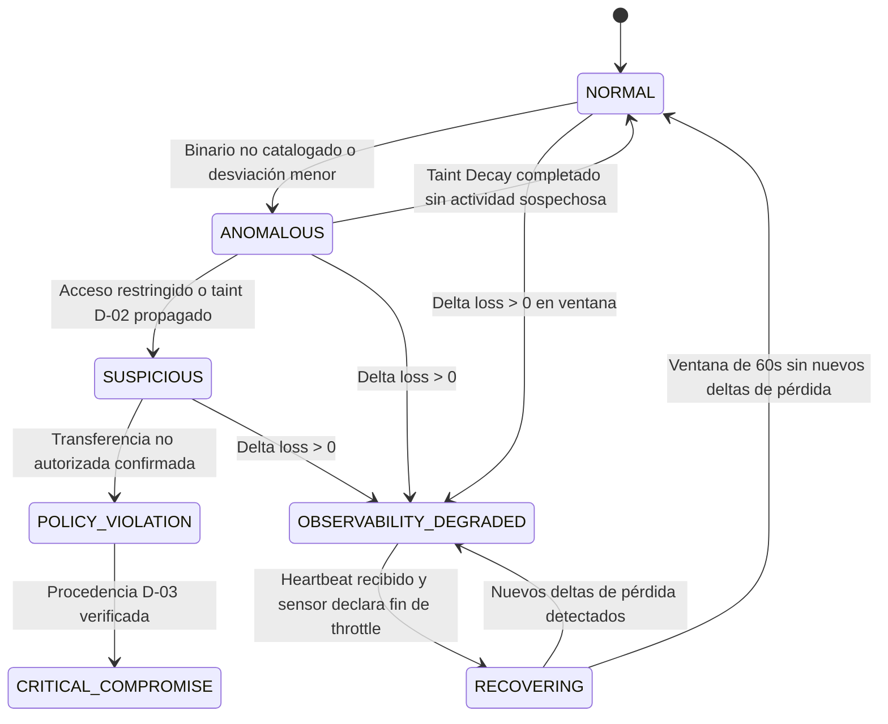

# SENTINEL RUNTIME — CAUSAL CORE V1 (REVISED)
**Normative Specification: Deterministic Causal Engine & State Machine**  
*Document ID:* `SPEC-CAUSAL-V1r2`  
*Status:* `FROZEN_FOR_REVIEW`  
*Revision:* Architecture Review 001  
*Baseline Reference:* Commit `fb4c5d638810e6a63cd35f68c50f5740e8db8d75`  
*Classification:* Technical Normative Contract

> **Implementation boundary:** This frozen-for-review document specifies a target causal engine. Its FSM, taint, and enforcement actions are not implemented by the current runtime. The code currently provides bounded process correlation and observe-only recommendations only; see [`../IMPLEMENTATION_STATUS.md`](../IMPLEMENTATION_STATUS.md).

---

## 1. Principios Fundamentales del Motor Causal

El motor causal de Sentinel Runtime (`Causal Core`) es un sistema formal determinista basado en Grafos Acíclicos Dirigidos (DAG) y máquinas de estados finitos (FSM).

Se rige por cuatro axiomas inmutables:

1. **Determinismo Estricto:** La misma secuencia ordenada de eventos de telemetría produce el mismo estado interno y la misma decisión. Prohibido el uso de LLM o heurísticas probabilísticas en la ruta crítica.
2. **Desacoplamiento de Parentesco y Causalidad (H-09):** La relación padre-hijo en el árbol de procesos NO implica automáticamente transmisión de culpabilidad ni de contaminación (taint).
3. **Identidad Inmune al Reciclaje (H-02 & H-07):** Toda correlación se apoya exclusivamente en el identificador opaco `exec_id`. El `pid` es un atributo volátil secundario.
4. **Proporcionalidad Epistémica del Enforcement:** Una acción destructiva no reversible requiere certeza `VERIFIED`. Ante evidencia incompleta o pérdida de telemetría, el sistema degrada su confianza y prohíbe acciones destructivas.

---

## 2. Los Dos Grafos Ortogonales: Lineage vs. Evidence

```text
┌──────────────────────────────────┐        ┌───────────────────────────────────────────────┐
│  PROCESS LINEAGE GRAPH (PLG)     │        │          CAUSAL EVIDENCE GRAPH (CEG)           │
├──────────────────────────────────┤        ├───────────────────────────────────────────────┤
│ ¿Quién creó a quién?             │   ≠    │ ¿Qué eventos y recursos compartieron          │
│ Relaciones parent_exec_id →      │        │ información de forma demostrable?              │
│ exec_id (fork/clone/execve)      │        │                                               │
│                                  │        │ Solo aristas con evidencia observacional       │
└──────────────────────────────────┘        └───────────────────────────────────────────────┘
```

### 2.1 Process Lineage Graph (PLG)
- **Definición:** Bosque de árboles dirigidos donde los nodos son procesos (`exec_id`) y las aristas `(u, v)` representan creación (`u = parent_exec_id`, `v = exec_id`).
- **Propósito:** Trazabilidad genealógica, herencia de namespaces, resolución jerárquica.
- **Limitación Normativa:** Un camino en el PLG entre $A$ y $B$ es condición necesaria pero **no suficiente** para propagar sospecha.

### 2.2 Causal Evidence Graph (CEG)
- **Definición:** Hipergrafo dirigido temporalmente donde:
  - $\mathcal{V} = \mathcal{P} \cup \mathcal{R} \cup \mathcal{E}$ (Procesos, Recursos, Eventos).
  - Recursos $\mathcal{R}$: Inodos de archivos, sockets de red, descriptores de archivo, canales IPC.
  - Aristas causales $\mathcal{E}_{\text{causal}}$:
    - $\text{READS}(P, R, t)$: Proceso $P$ leyó bytes del recurso $R$.
    - $\text{WRITES}(P, R, t)$: Proceso $P$ escribió bytes al recurso $R$.
    - $\text{INHERITS\_FD}(P_1, P_2, fd)$: Proceso $P_2$ heredó el descriptor $fd$ de $P_1$ a través de `fork`/`execve`.
    - $\text{IPC\_TRANSFER}(P_1, P_2, channel, t)$: Transferencia verificada de bytes vía pipe, socket UNIX, o `shm`.
    - $\text{FORK\_MEMORY\_SNAPSHOT}(P_1, P_2, t)$: $P_2$ fue creado por `fork()` de $P_1$ y heredó una copia COW del espacio de memoria.
    - $\text{TAINT\_PROPAGATED}(P_1, P_2, \text{mechanism}, \text{evidence\_level})$: Propagación con causa explícita y nivel de evidencia.

---

## 3. Identidad, Ciclo de Vida y Semántica de Procesos Unix (AR-02)

### 3.1 Prevención de PID Recycling
Cuando `PROCESS_EXIT` llega:
1. Se sella la cadena causal del `exec_id`.
2. Se desvincula el mapa transitorio `pid → exec_id`.
3. Se archiva el nodo en el CEG histórico.
Si el kernel reasigna el mismo `pid`, el nuevo proceso obtiene un `exec_id` distinto y comienza con estado `NORMAL` y score 0.

### 3.2 Hilos (Threads) vs. Procesos Independientes
- **Hilos POSIX (`clone` con `CLONE_THREAD | CLONE_VM`):**
  - Comparten `pid` (TGID), espacio de memoria virtual y tabla de descriptores.
  - Tienen `tid` distintos.
  - *Regla:* Si el hilo $T_1$ lee un archivo sensible, todo el proceso $P$ queda marcado `TAINTED_MEMORY` porque todos los hilos comparten el mismo espacio de direcciones.
- **Procesos Bifurcados (`fork` / `clone` sin `CLONE_VM`):**
  - `pid` y `exec_id` independientes.
  - **El espacio de memoria se duplica vía Copy-On-Write (COW).**

### 3.3 Semántica Completa de fork(), exec() y la Cadena de Datos (AR-02)

La propagación de datos entre procesos Unix sigue caminos precisos que el motor causal debe modelar explícitamente:

#### A. `fork()` y Copy-On-Write (COW)
Cuando un proceso $P$ ejecuta `fork()`:
1. Se crea un proceso hijo $P_{\text{child}}$ con un nuevo `pid` (y nuevo `exec_id` de Tetragon).
2. $P_{\text{child}}$ recibe una **copia lógica completa** del espacio de direcciones virtuales de $P$ mediante Copy-On-Write.
3. Si $P$ tenía un secreto en memoria (leído previamente de `/proc/self/environ`), $P_{\text{child}}$ tiene acceso inmediato a esa copia en memoria.
4. Los descriptores de archivo abiertos de $P$ son **duplicados** en $P_{\text{child}}$ (los mismos `fd` apuntan a las mismas entradas en la tabla de archivos abiertos del kernel).

**Implicación para Taint:**
- Tras `fork()`, $P_{\text{child}}$ tiene **potencial acceso** a los datos sensibles que estaban en la memoria de $P$. Esto constituye **propagación potencial de datos**, no propagación verificada.

#### B. `execve()` y Sustitución del Espacio de Direcciones
Cuando un proceso (típicamente un hijo recién bifurcado) ejecuta `execve()`:
1. El espacio de memoria completo del proceso se **reemplaza** por la imagen del nuevo binario.
2. Los datos que estaban en la memoria del padre ya no son accesibles desde la nueva imagen.
3. Los descriptores de archivo que **no** tienen el flag `O_CLOEXEC` (`FD_CLOEXEC`) **sobreviven** al `execve` y permanecen abiertos.
4. Los descriptores con `O_CLOEXEC` se cierran automáticamente.

**Implicación para Taint:**
- `execve()` actúa como una **barrera de taint de memoria**: los datos residentes en RAM se pierden.
- `execve()` **no** es una barrera de taint de descriptores: los `fd` heredados sin `O_CLOEXEC` conservan acceso a archivos sensibles.

#### C. Descriptores de Archivo Heredados (FD Inheritance)
- `fork()` duplica la tabla de descriptores. El hijo puede leer/escribir los mismos archivos.
- `execve()` cierra solo los `fd` con `FD_CLOEXEC`.
- Pipes anónimos (`pipe()`) creados antes de `fork()` permiten comunicación directa entre padre e hijo.

#### D. Canales IPC Explícitos
- **Pipes anónimos:** Creados pre-fork; permiten transmisión unidireccional de datos padre→hijo o hijo→padre.
- **Sockets UNIX:** Permiten transmisión bidireccional entre procesos relacionados o no relacionados.
- **Shared Memory POSIX (`shm_open`) / System V (`shmget`):** Permite compartir regiones de memoria entre procesos no necesariamente emparentados.
- **Señales:** No transportan datos significativos para propósitos de taint.

---

## 4. Modelo Formal de Propagación de Datos (4 Niveles)

Para formalizar la diferencia entre posibilidad teórica y evidencia observada, Sentinel Runtime clasifica la propagación de datos en cuatro niveles:

### Nivel D-00: PROCESS_LINEAGE (Solo Parentesco)
- **Definición:** Existe una relación `parent_exec_id → exec_id` en el PLG.
- **Lo que demuestra:** Un proceso creó a otro.
- **Lo que NO demuestra:** Que existió transferencia de información.
- **Acción Causal:** Ninguna. No se propaga taint.

### Nivel D-01: POTENTIAL_DATA_PROPAGATION
- **Definición:** Existe un mecanismo por el cual los datos *podrían* haberse transferido, pero no se observó la transferencia.
- **Mecanismos:**
  - `fork()` con COW previo a `execve()`: El hijo tuvo acceso potencial a la memoria del padre.
  - Descriptores heredados sin `FD_CLOEXEC`: El hijo tiene abierto un `fd` que apunta a un recurso sensible.
  - Shared memory existente entre los dos procesos.
- **Lo que demuestra:** Existe un canal a través del cual los datos pudieron fluir.
- **Lo que NO demuestra:** Que los datos fueron efectivamente leídos, copiados o utilizados.
- **Acción Causal:** Se registra la relación potencial como arista `FORK_MEMORY_SNAPSHOT` o `INHERITS_FD` en el CEG. El motor **incrementa la vigilancia** pero **no propaga taint de forma automática**.

### Nivel D-02: OBSERVED_DATA_PROPAGATION
- **Definición:** Se observó una operación de lectura, escritura o transferencia en un canal compartido entre dos procesos vinculados.
- **Mecanismos:**
  - `write()` en pipe padre → `read()` en pipe hijo (observado por kprobes).
  - `sendmsg()` → `recvmsg()` en socket UNIX entre dos procesos.
  - `read()` en un `fd` heredado que apunta a un archivo sensible.
- **Lo que demuestra:** Se transfirieron bytes a través de un canal compartido.
- **Lo que NO demuestra:** Que los bytes contenían el secreto (a menos que exista correlación de volumen o contenido).
- **Acción Causal:** Se propaga taint al proceso receptor con nivel de evidencia `OBSERVED`.

### Nivel D-03: VERIFIED_DATA_PROVENANCE
- **Definición:** Existe una cadena causal completa y verificable desde la lectura del recurso sensible hasta la transmisión al destino externo.
- **Requisitos (TODOS):**
  1. `FILE_READ` confirmado sobre recurso restringido con `bytes_read > 0`.
  2. Propagación observada (`D-02`) o taint de memoria en el mismo hilo/proceso.
  3. `NETWORK_SEND_RESULT` con `return_code > 0` hacia destino no autorizado.
  4. Correlación temporal razonable (la transmisión ocurrió dentro de la ventana de vida del taint).
- **Acción Causal:** Permite escalamiento a `POLICY_VIOLATION` o `CRITICAL_COMPROMISE`.

---

## 5. Reglas Formales de Propagación de Taint (Revisadas con AR-02 y H-09)

### Regla T-01: Adquisición Primaria
Si el proceso $P$ ejecuta `FILE_READ` sobre recurso $R \in \text{RestrictedPaths}$ con $\text{bytes\_read} > 0$:
$$\text{TaintState}(P) \leftarrow \text{TaintState}(P) \cup \{ \tau_{\text{CONFIDENTIALITY}}(R, t_E, \text{D-02}) \}$$

### Regla T-02: Barrera Parental y Lateral
El taint de $P$ **nunca** se propaga a $P_{\text{parent}}$ ni a $P_{\text{sibling}}$ automáticamente. Solo se propaga si existe arista `IPC_TRANSFER` verificada en el CEG con timestamp posterior a la adquisición.

### Regla T-03: Fork — Propagación Potencial (No Automática)
Cuando $P$ (con taint activo) ejecuta `fork()`, el hijo $P_{\text{child}}$:
1. **Pre-execve:** Se marca con taint nivel `D-01` (`POTENTIAL_DATA_PROPAGATION`). El motor incrementa vigilancia pero **no escala a SUSPICIOUS ni a POLICY_VIOLATION** basándose solo en el fork.
2. **Post-execve:** Si $P_{\text{child}}$ invoca `execve()`:
   - El taint de memoria se **anula** (barrera de memoria).
   - El taint de descriptores persiste solo para `fd` sin `FD_CLOEXEC`.
3. **Sin execve:** Si $P_{\text{child}}$ opera sin ejecutar `execve`, retiene el taint de memoria del padre a nivel `D-01` (potencial, no verificado).

### Regla T-04: Herencia de Descriptores
Si $P$ (con taint) tiene un `fd` abierto apuntando al recurso sensible $R$ y $P_{\text{child}}$ ejecuta `read(fd)` sobre ese descriptor:
$$\text{TaintState}(P_{\text{child}}) \leftarrow \text{TaintState}(P_{\text{child}}) \cup \{ \tau_{\text{CONFIDENTIALITY}}(R, t_{\text{read}}, \text{D-02}) \}$$
El nivel de propagación sube a `D-02` (observada).

### Regla T-05: Transferencia IPC Observada
Si se observan `write(fd_pipe)` en $P$ y `read(fd_pipe)` en $P_{\text{child}}$ sobre el mismo pipe/socket UNIX con $P$ contaminado:
$$\text{TaintState}(P_{\text{child}}) \leftarrow \text{TaintState}(P_{\text{child}}) \cup \{ \tau_{\text{CONFIDENTIALITY}}(R, t_{\text{ipc}}, \text{D-02}) \}$$

### Regla T-06: Decaimiento Temporal (Taint Decay)
Las marcas de contaminación activa decaen a `TAINT_EXPIRED` tras $\Delta T_{\text{decay}} = 300\text{s}$ (configurable por workload) si el proceso no realiza comunicación externa, IPC ni escrituras a disco.

---

## 6. Máquina de Estados Formal con Recuperación de Observabilidad (AR-04)

El motor mantiene **7 estados formales** (se añade `RECOVERING`):



### Definición de los 7 Estados:

| Estado | Evidencia Mínima | Enforcement Máximo |
|---|---|---|
| `NORMAL` | 0 anomalías, 0 accesos no autorizados, sensor saludable. | `RECORD_ONLY` |
| `ANOMALOUS` | Binario no catalogado. Puntuación: 1–39. | `INCREASE_LOGGING` |
| `SUSPICIOUS` | Acceso restringido + taint D-01/D-02. Puntuación: 40–69. | `ISOLATE_NETWORK` |
| `POLICY_VIOLATION` | Transferencia no autorizada con taint D-02. Puntuación: 70–89. | `SUSPEND_PROCESS` |
| `CRITICAL_COMPROMISE` | Procedencia D-03 verificada. Puntuación: ≥ 90. | `TERMINATE_PROCESS` (solo con confianza `VERIFIED`) |
| `OBSERVABILITY_DEGRADED` | Delta de contadores `loss_*` > 0 en la ventana actual. | `INCREASE_LOGGING` (prohibido escalar) |
| `RECOVERING` | Sensor reporta heartbeat saludable; contadores de pérdida estabilizados. | `INCREASE_LOGGING` (manteniendo vigilancia elevada) |

### Recuperación de Observabilidad (AR-04):
1. **Entrada a `OBSERVABILITY_DEGRADED`:** Se calcula el **delta** de los contadores `loss_*` por ventana temporal (no el acumulado absoluto). Si $\Delta(\text{loss}) > 0$ en la ventana actual, se transiciona.
2. **Transición a `RECOVERING`:** Requiere recepción de un evento `SENSOR_HEALTH` con contadores estabilizados y el sensor declarando fin de throttle.
3. **Retorno a `NORMAL`:** Requiere una ventana completa de 60 segundos sin nuevos deltas de pérdida y sin desconexiones de transporte gRPC.
4. **Regla Anti-Amnesia:** La ausencia de eventos durante un período no significa ausencia de actividad. Si el sensor deja de emitir eventos (heartbeat perdido), el estado se mantiene en `OBSERVABILITY_DEGRADED` hasta recibir un heartbeat explícito.

---

## 7. Desacoplamiento Cuádruple de Decisiones de Seguridad

Toda evaluación se expresa como una 4-tupla desacoplada:
$$\text{Decision} = \langle \mathcal{C}, \mathcal{S}, \mathcal{P}, \mathcal{A} \rangle$$

1. **Confianza ($\mathcal{C}$):** `LOW`, `MEDIUM`, `HIGH`, `VERIFIED`.
   - `PARTIAL_ORPHAN` o `loss > 0` $\implies \mathcal{C} \le \text{LOW}$.
   - Taint solo de nivel `D-01` (potencial) $\implies \mathcal{C} \le \text{MEDIUM}$.
2. **Severidad ($\mathcal{S}$):** `INFO`, `LOW`, `MEDIUM`, `HIGH`, `CRITICAL`.
3. **Política ($\mathcal{P}$):** `ALLOW`, `AUDIT`, `RESTRICT`, `BLOCK`.
4. **Enforcement ($\mathcal{A}$):** `RECORD_ONLY`, `INCREASE_LOGGING`, `ISOLATE_NETWORK`, `SUSPEND_PROCESS`, `TERMINATE_PROCESS`.

### Matriz Vinculante: Certeza vs. Enforcement

| Confianza ($\mathcal{C}$) | Severidad ($\mathcal{S}$) | Máximo Enforcement ($\mathcal{A}_{\max}$) |
|---|---|---|
| `LOW` | Cualquiera | `RECORD_ONLY` / `INCREASE_LOGGING`. Prohibido intervenir. |
| `MEDIUM` | `LOW` – `MEDIUM` | `RECORD_ONLY` / `INCREASE_LOGGING`. |
| `MEDIUM` | `HIGH` – `CRITICAL` | `ISOLATE_NETWORK` (Reversible). |
| `HIGH` | `MEDIUM` – `HIGH` | `SUSPEND_PROCESS` (Reversible). |
| `VERIFIED` | `CRITICAL` | `TERMINATE_PROCESS` (Irreversible). |

> **REGLA DE ORO:** Ningún proceso puede ser terminado destructivamente a menos que confianza = `VERIFIED`, estado = `CRITICAL_COMPROMISE`, y nivel de evidencia = `D-03` (`VERIFIED_DATA_PROVENANCE`).

---

## 8. Criterios de Aceptación

- [ ] **AC-CC-01:** PID reciclado → nuevo proceso en `NORMAL` con score 0.
- [ ] **AC-CC-02:** Worker benigno hermano de proceso comprometido → `NORMAL` con 0 bloqueos.
- [ ] **AC-CC-03:** `delta(loss) > 0` → `OBSERVABILITY_DEGRADED` → prohibición de `TERMINATE_PROCESS`.
- [ ] **AC-CC-04:** 1,000 trazas idénticas → mismo hash de estado final (determinismo).
- [ ] **AC-CC-05 (AR-02):** Fork con secreto en memoria → hijo obtiene taint `D-01` (potencial) no `D-02` (observado).
- [ ] **AC-CC-06 (AR-02):** Fork + execve → barrera de taint de memoria; solo persisten `fd` sin `CLOEXEC`.
- [ ] **AC-CC-07 (AR-04):** Recuperación de `OBSERVABILITY_DEGRADED` requiere 60s de heartbeats sin deltas.
