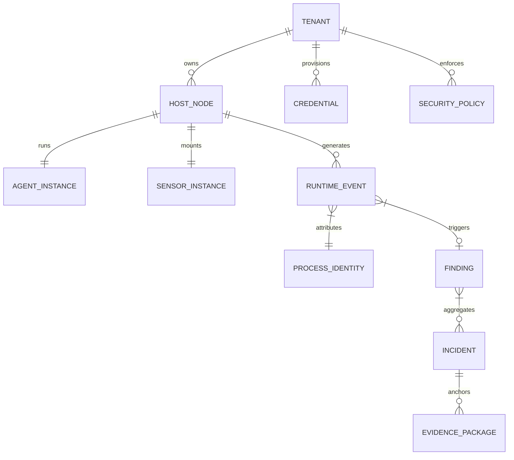
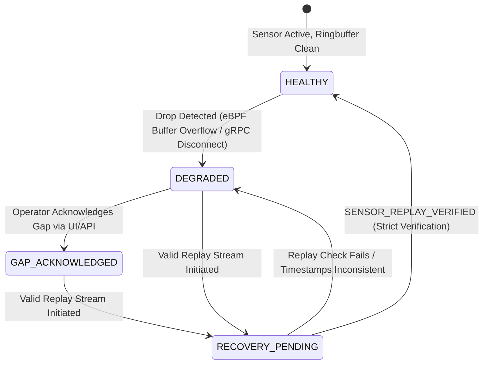
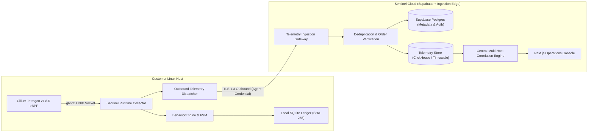
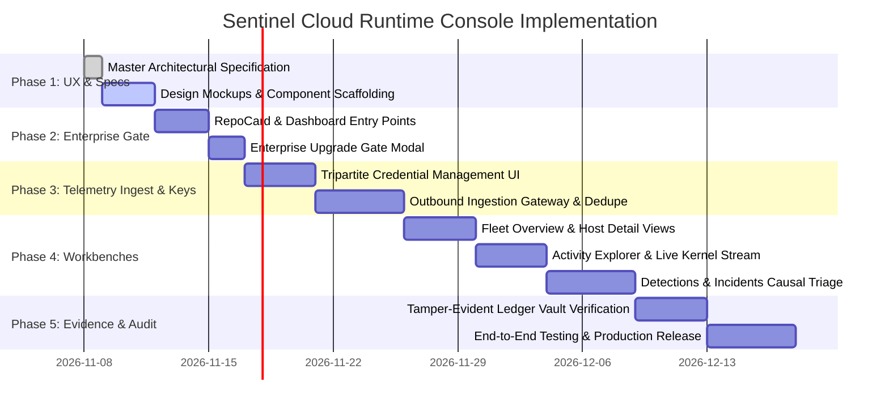

# Sentinel Cloud: Runtime Security Operations Console Specification (v1)

**Document Identifier:** `SENTINEL_CLOUD_RUNTIME_CONSOLE_SPEC_V1`  
**Classification:** Technical Architecture & UI/UX Product Specification  
**Version:** 1.0.0-PROPOSED  
**Status:** Under Architectural Review  
**Date:** 2026-11-08  
**Target Systems:** `sentinel-cloud` (Next.js 14 App Router, TypeScript, Tailwind CSS, Supabase) and `sentinel-runtime` (Node.js LTS, Tetragon v1.8.0 eBPF)

---

## Executive Summary

This specification establishes the end-to-end information architecture, visual design language, role-based access control, and user experience for the **Sentinel Cloud: Runtime Security Operations Console**.

Unlike generic chatbot interfaces or toy telemetry dashboards, Sentinel Cloud delivers a deterministic, high-throughput security intelligence platform for Linux workloads, Kubernetes clusters, and AI agent execution environments. It unites static Code-to-Cloud posture with real-time, microsecond-level eBPF kernel telemetry captured by `sentinel-runtime` and Cilium Tetragon.

### Core Principles
1. **Universal Security Truth:** A single, normalized security information model serves the entire organization. Views differ by role and persona, but underlying telemetry, indicators, and hashes are identical.
2. **Deterministic Forensic Integrity:** No alert or incident is displayed without verifiable origin event keys and SHA-256 ledger integrity. Gaps in telemetry are strictly surfaced as `GAP_ACKNOWLEDGED` without artificial smoothing or simulated recovery.
3. **Enterprise Gated Access:** Runtime fleet administration and real-time telemetry consumption are strictly restricted to customers with an active **Annual Enterprise Subscription** (`tier === 'ENTERPRISE'` and `runtimeFleetEnabled === true`).
4. **Zero Open Inbound Ports:** Customer infrastructure never listens for inbound cloud connections. All telemetry is dispatched via authenticated reverse-outbound TLS 1.3 streams.
5. **Observe-Only Safety:** Runtime enforcement remains strictly advisory in this phase. Autonomous disruptive actions (`autoContain`) remain locked down; R2/R3 actions require explicit human operator confirmation.

---

## 1. Navigation Architecture

The Sentinel Cloud navigation incorporates the Runtime Security module into the existing dashboard structure seamlessly without disrupting existing static repository scanning workflows.

```
SENTINEL CLOUD CONSOLE
│
├── /dashboard (Main Workspace)
│   ├── Monitored Code Nodes (RepoCard Grid)
│   │   └── [RepoCard] ──► [Runtime Badge / Launch Console]
│   └── Top Navigation Bar ──► [Runtime Fleet Console]
│
└── /runtime (Runtime Fleet Console - Enterprise Gate Protected)
    │
    ├── /runtime/overview (Executive & Threat Posture)
    ├── /runtime/fleet (Hosts, Nodes, and Sensor Health)
    │   └── /runtime/fleet/[host_id] (Host Detail, Boot & Process Graph)
    ├── /runtime/explorer (Live & Historical Kernel Telemetry Stream)
    ├── /runtime/detections (FSM Complex Event Detections)
    │   └── /runtime/detections/[finding_id] (Sequence & Rule Context)
    ├── /runtime/incidents (Correlated Multi-Host Incidents)
    │   └── /runtime/incidents/[incident_id] (Causal Graph, Triage & Timeline)
    ├── /runtime/evidence (Tamper-Evident Ledger Vault)
    │   └── /runtime/evidence/[batch_id] (Merkle Proofs & Chain Verifier)
    ├── /runtime/rules (Detection Engineering & Tetragon TracingPolicies)
    ├── /runtime/credentials (Tripartite Keys, Tokens & Rotation)
    └── /runtime/settings (Quota Governance, Data Retention & Retention Policies)
```

### 1.1 Breadcrumbs & Sub-Navigation Standard
Every sub-route within `/runtime` exposes a standardized breadcrumb and status banner:
```
[Sentinel Cloud] / [Runtime Operations] / [Fleet] / [node-prod-eu-west-01] / [Process Tree: exec_id=a8f9...]
```
The sub-navigation header displays:
- **Global Fleet Pulse:** Active Hosts, Sensor Degradation Count, 24h Intercepted Suspicious Sequences.
- **Tenant Scope Indicator:** Organization name, Active Tier badge (`ENTERPRISE ANNUAL`), Host Quota (`X / 25 Hosts Used`).
- **Telemetry Health Status:** `SYNCED (Live TLS 1.3 Stream)` or `DEGRADED (1 Node Gap Detected)`.

---

## 2. Universal Security Information Model

All screens, ingestion pipelines, database schemas, and export formats share a canonical entity model:



### 2.1 Entity Definitions & Normalized Schemas

| Entity | Primary Identifiers | Key Attributes | Ingestion & Integrity Rules |
| :--- | :--- | :--- | :--- |
| **Tenant** | `tenant_id` (UUIDv4) | `name`, `tier`, `subscription_cycle`, `max_hosts`, `retention_days` | Root security boundary; RLS isolated. |
| **Host Node** | `host_id` (UUIDv4) | `hostname`, `boot_id`, `kernel_release`, `arch`, `os_name`, `public_ip`, `private_ip`, `status` (`HEALTHY`, `DEGRADED`, `OFFLINE`) | Identified by `(tenant_id, host_id, boot_id)`. Re-boot changes `boot_id`. |
| **Agent Instance** | `agent_id` (UUIDv4) | `agent_version`, `started_at`, `last_heartbeat_at`, `observability_state`, `gap_acknowledged_flag` | Reports health every 15s. Absence > 60s triggers `HOST_UNREACHABLE`. |
| **Sensor Instance** | `sensor_id` (string) | `engine` (`TETRAGON_EBPF`), `version` (`1.8.0`), `bpf_maps_healthy`, `lost_events_counter` | Tracks ring-buffer drop counters directly from kernel perf-event maps. |
| **Process Identity** | `exec_id` (base64/string) | `pid`, `ppid`, `binary_path`, `args`, `user_id`, `user_name`, `cgroup`, `container_id`, `attribution_level` | Strong identity via Tetragon `exec_id`. If process preceded sensor, `attribution_level = PARTIALLY_ATTRIBUTED`. |
| **Runtime Event** | `event_id` (UUIDv5) | `timestamp_iso`, `event_type` (`PROCESS_EXEC`, `FILE_ACCESS`, `NETWORK_CONNECT`, `SOCKET_DATA`), `process`, `parent`, `details` | Deterministic deduplication key: `hash(host_id, boot_id, exec_id, event_type, seq)`. |
| **Finding (Detection)** | `finding_id` (string) | `rule_id`, `severity` (`LOW`, `MED`, `HIGH`, `CRITICAL`), `confidence`, `fsm_state`, `evidence_sequence` | Generated by FSM Complex Event Engine. Sequence must be strictly ordered chronologically. |
| **Incident** | `incident_id` (UUIDv4) | `correlation_key`, `primary_tactic` (MITRE ATT&CK), `hosts_affected`, `verdict`, `status` (`OPEN`, `TRIAGED`, `RESOLVED`, `FALSE_POSITIVE`) | Correlates multiple findings across host identities and timelines. |
| **Evidence Package** | `evidence_id` (UUIDv4) | `ledger_start_seq`, `ledger_end_seq`, `local_ledger_hash`, `remote_anchor_hash`, `tamper_status` | Cryptographic SHA-256 chain verification. Tamper attempts immediately flag invalid verification. |
| **Security Policy** | `policy_id` (string) | `policy_name`, `mode` (`OBSERVE_ONLY`), `tetragon_tracing_policy_yaml`, `active_revision` | Observe-only policy enforcement. R2/R3 containment triggers require manual operator approval. |
| **Credential** | `credential_id` (UUIDv4) | `credential_type` (`CUSTOMER_API_KEY`, `ENROLLMENT_TOKEN`, `AGENT_CREDENTIAL`), `key_prefix`, `hashed_secret`, `expires_at`, `status` | Tripartite credential model. Raw secrets never stored in plaintext. |

---

## 3. Screen Specifications (Detailed UX/UI Breakdown)

Each screen in the Runtime Console is engineered for clarity, information density, and rapid operational decision-making.

### Screen 1: Executive Posture & Overview (`/runtime/overview`)
- **Objective:** Answer *"What is the threat and operational posture of my enterprise infrastructure right now?"*
- **Primary Data Fields:**
  - Active Host Fleet Count (`Active / Enrolled / Max Quota`).
  - Kernel Sensor Health Gauge (`100% Monitored`, `X Nodes Degraded`).
  - Active Incidents by Severity (Critical, High, Medium, Low).
  - MITRE ATT&CK Matrix Overlay: Real-time heat-map showing detected runtime tactics (Execution, Persistence, Defense Evasion, Credential Access, Discovery, Lateral Movement, Exfiltration).
  - Telemetry Throughput: Events/sec processed, average processing latency (< 2.5ms).
- **Controls & Filters:** Time horizon selector (Last 1 hour, 6 hours, 24 hours, 7 days, 30 days).
- **States:**
  - *Loading:* Pulse shimmer skeleton on metrics cards and ATT&CK grid.
  - *Empty:* Onboarding banner: *"No hosts enrolled yet. Generate your first Enrollment Token to connect your servers."*
  - *Error:* Red alert banner with retry button: *"Failed to refresh executive posture. Reconnecting to telemetry cluster..."*
- **Required RBAC:** Read access across all roles (IT Admin, SOC, SecEng, Executive, Auditor).

### Screen 2: Assets & Runtime Fleet (`/runtime/fleet`)
- **Objective:** Comprehensive inventory of all registered Linux servers, Kubernetes nodes, and container execution environments.
- **Primary Data Fields:**
  - Table Columns: Hostname, Host ID (with copy button), Boot ID, IP Addresses (Private / Public), OS & Kernel Version (`Linux 6.8.0-generic x86_64`), Tetragon Sensor Status (`ACTIVE v1.8.0`), Agent State (`HEALTHY`, `GAP_ACKNOWLEDGED`, `DEGRADED`, `OFFLINE`), Last Heartbeat (relative time + timestamp).
  - Action Dropdown: View Process Graph, Inspect Ledger Evidence, Rotate Host Credential, Decommission Node.
- **Controls & Filters:** Search by hostname/IP/ID, filter by Status (`All`, `Degraded Only`, `Offline`), filter by Kernel Version or Tag.
- **States:**
  - *Empty:* Step-by-step installation instructions for `systemd` and Docker/Kubernetes daemonsets.
  - *Degraded Host Highlight:* Hosts in `DEGRADED` or `GAP_ACKNOWLEDGED` display an amber/red glowing pill with a quick tooltip: *"Telemetry gap detected at 2026-11-08 04:12:00 UTC. Ring-buffer drops: 142 events. Containment capabilities locked."*
- **Required RBAC:** Read for all roles; Node Decommissioning and Credential Rotation restricted to `Tenant Admin` and `Security Engineer`.

### Screen 3: Activity Explorer - Live Kernel Stream (`/runtime/explorer`)
- **Objective:** Deep exploration of raw and enriched runtime events straight from Tetragon eBPF.
- **Primary Data Fields:**
  - Structured Event Log: Time (UTC with microsecond precision), Event Type badge (`EXEC`, `OPEN`, `CONNECT`, `CLOSE`), Process Name (`curl`, `bash`, `python3`), Exec ID, PID, UID, Parent Process, Socket Details (`TCP 192.168.1.50:443 -> 198.51.100.2:4444`), Return Code.
  - Event Inspector Drawer (Sliding Panel): Full raw JSON contract, Tetragon kernel context, process capabilities, namespace/cgroup metadata, and local ledger block hash.
- **Controls & Filters:**
  - Filter bar supporting key-value syntax: `process.name:nc OR event_type:CONNECT destination.port:4444`.
  - Pause / Resume Live Streaming toggle.
  - Export View: Export to NDJSON, CSV, or formatted SIEM bundle.
- **States:**
  - *Streaming:* Smooth virtualized scrolling list sustaining up to 10,000 events in memory without UI stutter.
  - *Paused:* Amber top-banner indicating stream is paused with count of buffered incoming events.
- **Required RBAC:** Read access for SOC Analyst, DFIR, and Security Engineer.

### Screen 4: Detections Center (`/runtime/detections`)
- **Objective:** Triage and inspect alerts generated by the complex event processing (FSM) engine.
- **Primary Data Fields:**
  - Detection Table: Finding ID, Timestamp, Detection Rule Name (`SUSPICIOUS_EXFILTRATION_SEQUENCE`, `UNEXPECTED_SHELL_SPAWN`, `CREDENTIAL_ACCESS_ATTEMPT`), Target Host, Severity, Confidence Score (e.g. `0.94`), FSM Sequence Steps (e.g. `OPEN_SENSITIVE -> FORK_WORKER -> OUTBOUND_SOCKET`), Status (`NEW`, `IN_REVIEW`, `SUPPRESSED`, `ESCALATED`).
  - Sequence Visualizer: Step-by-step horizontal timeline displaying the exact causality of the sequence.
- **Controls & Filters:** Filter by Rule, Severity, Host, Date Range, Status.
- **Required RBAC:** SOC Analyst (Triage, Comment, Escalate), Security Engineer (Suppress, Tune Rule).

### Screen 5: Incidents & Causal Triage (`/runtime/incidents`)
- **Objective:** High-severity incident management with causal attribution and cross-host correlation.
- **Primary Data Fields:**
  - Incident Dossier: Incident Title, Primary Threat Actor / Technique, Affected Hosts & Workloads, First Seen / Last Seen, Containment Recommendation, Human Decision Log.
  - Interactive Causal Process Tree: Visual DAG rendering parent-child process relationships with suspicious events highlighted in pulsing red nodes.
  - Evidence Ledger Reference: Anchored SHA-256 block hash for legal and regulatory admissibility.
- **Controls & Actions:**
  - Action Bar: `Acknowledge Incident`, `Request Process Suspension (R2 Manual Approval Required)`, `Export Forensic Dossier (PDF/JSON)`.
  - Filter by Resolution State (`Active`, `Triaged`, `Contained`, `Closed`).
- **Required RBAC:** Incident Responder, SOC Analyst, Tenant Admin.

### Screen 6: Evidence Center - Tamper-Evident Ledger Vault (`/runtime/evidence`)
- **Objective:** Verify and audit cryptographic proof of event authenticity and chain-of-custody.
- **Primary Data Fields:**
  - Evidence Block Table: Batch ID, Host ID, Sequence Range (`seq 14001 - 15000`), Record Count, Local Ledger Hash (SHA-256), Cloud Remote Anchor Hash, Sync Timestamp, Verification Status (`VERIFIED_INTACT`, `HASH_MISMATCH_TAMPER_DETECTED`, `GAP_PRESENT`).
  - Verification Tool: Click to run client-side SHA-256 re-computation comparing local block hashes against the Cloud immutable anchor.
- **States:**
  - *Verified Intact:* Green shield icon with verified cryptographic signature.
  - *Tamper Detected:* Flashing red banner: *"CRYPTOGRAPHIC CHAIN FAILURE: Event sequence #14205 has been modified or omitted on host node-01. Chain integrity voided."*
- **Required RBAC:** DFIR Investigator, Compliance Auditor, Security Engineer.

### Screen 7: Detection Engineering & Sensor Rules (`/runtime/rules`)
- **Objective:** Manage and author behavioral FSM rules and Tetragon `TracingPolicy` definitions.
- **Primary Data Fields:**
  - Rule List: Rule ID, Title, Engine (`RUNTIME_FSM` or `TETRAGON_KPROBE`), Target System Calls (`sys_enter_execve`, `sys_enter_connect`), State Transitions (`IDLE -> SENSITIVE_READ -> CONNECT_EXTERNAL`), Mode (`OBSERVE_ONLY`), Rule Status (`ACTIVE`, `TESTING`, `DISABLED`).
  - Policy Editor: Split-pane YAML/JSON editor with syntax validation and Tetragon schema linting.
- **Required RBAC:** Security Engineer and Tenant Admin only (Strict write restrictions).

### Screen 8: Integrations, Fleet Enrollment & Credentials (`/runtime/credentials`)
- **Objective:** Secure enrollment of customer hosts and generation of API keys for SIEM/SOAR pipelines.
- **Primary Data Fields & Controls:**
  - Tripartite Credential Management (Detailed in Section 4):
    1. Customer API Keys: Table of keys (`snt_live_...`), scopes, last used, expiration.
    2. Enrollment Tokens: Generate new single-use token (`snt_enroll_...`) with 15-minute TTL.
    3. Active Agent Credentials: Table of node keys (`snt_rt_...`), assigned host, creation date, revocation button.
- **Required RBAC:** Tenant Admin only.

### Screen 9: Administration & Quota Governance (`/runtime/settings`)
- **Objective:** Host quota management, billing tier alignment, data retention policies, and audit logging.
- **Primary Data Fields:**
  - Subscription Information: Current Plan (`ENTERPRISE ANNUAL`), Host Allocation (`12 of 25 Hosts Registered`), Retention Policy (`365 Days Historical Telemetry`).
  - Data Retention Controls: Telemetry auto-pruning parameters, S3/GCS Cold Storage export configurations.
  - Audit Trail: Immutable log of all console actions, credential creations, rule modifications, and incident escalations.
- **Required RBAC:** Tenant Admin only.

---

## 4. Tripartite Credential & API Key Management Model

To prevent credential theft from compromising the entire fleet, Sentinel enforces three strictly separated credential tiers:

```
┌────────────────────────────────────────────────────────────────────────┐
│                        TRIPARTITE CREDENTIAL MODEL                     │
├────────────────────┬─────────────────────┬─────────────────────────────┤
│ 1. ENROLLMENT TOKEN│ 2. AGENT CREDENTIAL │ 3. CUSTOMER API KEY         │
│ (Registration Only)│ (Node Telemetry)    │ (Console / SIEM Integration)│
├────────────────────┼─────────────────────┼─────────────────────────────┤
│ • Scoped: Register │ • Scoped: Ingestion │ • Scoped: REST API / Export │
│ • TTL: 15 Minutes  │ • TTL: 90 Days      │ • TTL: Configurable (1 Year)│
│ • Single-Use       │ • Bound to 1 Host   │ • Bound to Tenant Org       │
│ • Admin generated  │ • Auto-provisioned  │ • Admin generated           │
│ • No data access   │ • No query access   │ • Full RBAC permissions     │
└────────────────────┴─────────────────────┴─────────────────────────────┘
```

### 4.1 Lifecycle & One-Time Secret Disclosure Modal
1. **Creation:** When an administrator creates a Customer API Key or Enrollment Token, Sentinel Cloud generates a cryptographically secure random 256-bit entropy token formatted with standard prefixes:
   - Customer API Key: `snt_live_[32 hex characters]`
   - Enrollment Token: `snt_enroll_[32 hex characters]`
   - Agent Credential: `snt_rt_[32 hex characters]`
2. **Storage:** Sentinel Cloud computes `SHA-256(secret + salt)` for lookup and verification. The plaintext secret is **never** persisted in the database.
3. **One-Time Disclosure UI:** The secret is displayed once in a high-security dialog with a copy button, a QR code, and explicit warning: *"This token will never be shown again. Store it securely in your secret manager or environment configuration."*
4. **Host-Side Storage:** The `snt_rt_...` Agent Credential received during enrollment is stored exclusively in `/etc/sentinel-runtime/agent.env` with POSIX file permissions `0600` (owned by `root:root`).
5. **Zero-Downtime Rotation:** Agents support overlapping credentials during rotation. A new credential can be staged before the active credential expires or is revoked.

---

## 5. Role-Based Access Control (RBAC) & Enterprise Gate

### 5.1 Annual Enterprise Gate Logic
Access to the Runtime Console and any telemetry endpoints is protected by an authorization gate:

```typescript
// Architectural Gate Rule
export function canAccessRuntimeConsole(userProfile: UserProfile): boolean {
  const isEnterprise = userProfile.tier === 'ENTERPRISE';
  const hasFleetEnabled = userProfile.capabilities?.runtimeFleetEnabled === true;
  const isAnnualOrValid = userProfile.billing_cycle === 'ANNUAL' || userProfile.is_pilot_authorized === true;
  
  return isEnterprise && hasFleetEnabled && isAnnualOrValid;
}
```

If a user without an Annual Enterprise plan attempts to navigate to `/runtime` or clicks on a Runtime entry point in `RepoCard`, the application presents the **Enterprise Runtime Upgrade Gate Modal** (described in Section 8).

### 5.2 Console Role Matrix

| Action / Capability | Tenant Admin | Security Engineer | SOC Analyst | DFIR Investigator | IT Ops Admin | Compliance Auditor |
| :--- | :---: | :---: | :---: | :---: | :---: | :---: |
| View Overview & Posture | ✓ | ✓ | ✓ | ✓ | ✓ | ✓ |
| View Fleet Inventory & Health | ✓ | ✓ | ✓ | ✓ | ✓ | Read-only |
| Generate Enrollment Tokens | ✓ | ✓ | ✗ | ✗ | ✗ | ✗ |
| Rotate / Revoke Node Keys | ✓ | ✓ | ✗ | ✗ | ✗ | ✗ |
| Decommission Host Node | ✓ | ✗ | ✗ | ✗ | ✗ | ✗ |
| Inspect Live Kernel Stream | ✓ | ✓ | ✓ | ✓ | ✗ | Read-only |
| Triage & Comment Detections | ✓ | ✓ | ✓ | ✓ | ✗ | ✗ |
| Acknowledge Telemetry Gap | ✓ | ✓ | ✓ | ✗ | ✗ | ✗ |
| Approve R2 Process Containment | ✓ | ✓ | ✗ | ✗ | ✗ | ✗ |
| View Cryptographic Evidence | ✓ | ✓ | ✓ | ✓ | Read-only | ✓ |
| Export Evidence & Dossiers | ✓ | ✓ | ✓ | ✓ | ✗ | ✓ |
| Edit Detection Rules & Policy | ✓ | ✓ | ✗ | ✗ | ✗ | ✗ |
| Manage API Keys & Billing | ✓ | ✗ | ✗ | ✗ | ✗ | ✗ |

---

## 6. Observability, Telemetry Degradation & Forensic UX

Sentinel's brand reputation rests upon deterministic accuracy. The UI must never pretend data is complete when it is not.

### 6.1 Telemetry Gap State Machine & UX Manifestation



1. **`DEGRADED` State Display:**
   - When Tetragon reports dropped events or the gRPC stream experiences disruption, the host badge switches to pulsing red: `DEGRADED (GAP DETECTED)`.
   - The UI displays an unclosable warning bar: *"Telemetry gap detected on this host. 312 kernel events were dropped between 10:14:02 and 10:14:18 UTC. Automated containment actions are disabled."*
2. **`GAP_ACKNOWLEDGED` State Display:**
   - An operator can click `Acknowledge Gap`. This updates the operational state to `GAP_ACKNOWLEDGED`.
   - **Crucial Rule:** `GAP_ACKNOWLEDGED` does **NOT** clear degradation. The badge turns amber, `observabilityDegraded` remains `true`, and containment actions remain locked. The UI records the analyst's identity, timestamp, and audit justification.
3. **`PARTIALLY_ATTRIBUTED` Process Lineage:**
   - If a process began before Tetragon started or during an acknowledged gap, its parent lineage cannot be proven with 100% certainty.
   - The UI process tree renders the node with a dashed border and an explicit badge: `PARTIALLY_ATTRIBUTED (PRE-EXISTING OR GAP BOUNDARY)`. It never hallucinates fake parentage.

---

## 7. Role-Based Workspaces

The console provides role-tailored view presets that filter and prioritize relevant widgets:

### 7.1 IT Administrator Workspace
- Focus: Host availability, CPU/Memory overhead of `sentinel-runtime` (< 1.5% CPU, < 64MB RAM), kernel compatibility, agent versions, and host upgrade scheduling.
- Suppresses: Deep hex dumps, MITRE ATT&CK tactical mapping, and causal DAG drill-downs.

### 7.2 SOC Analyst Workspace
- Focus: Fast incident triage queue, alert urgency sorting, quick host status, one-click escalation to Incident Responders, and activity search.
- Prominent Actions: Assign ticket, mark false positive with justification, acknowledge gap.

### 7.3 Security Engineer Workspace
- Focus: Rule tuning, FSM state graph inspection, Tetragon TracingPolicy deployment, false positive reduction metrics, and API integration status.

### 7.4 DFIR (Forensic Investigator) Workspace
- Focus: Microsecond process timeline, raw event causality, file read/write sequence, network destination attribution, and cryptographic evidence exports.

### 7.5 Future Workspaces `[BACKLOG / FUTURE]`
- **CloudSec / CSPM View:** Multi-cloud posture and IAM policy drift (Planned Phase 6).
- **Automated Malware Sandbox:** Dynamic detonation chamber for intercepted ELF binaries (Planned Phase 7).
- **Red Team / Pentester View:** Attack simulation validation and detection coverage testing (Planned Phase 8).

---

## 8. Reusable UI Components & Dashboard Integration

### 8.1 Entry Point: `RepoCard` Integration (`src/components/RepoCard.tsx`)
In Sentinel Cloud, each monitored repository represents a software artifact and deployment target. The `RepoCard` is enhanced with a dedicated Runtime status indicator and entry point.

```tsx
// RepoCard.tsx - Runtime Action Section
<div className="relative z-10 flex items-center justify-between border-t border-amber-900/30 pt-2.5 mt-2">
  <div className="flex items-center gap-1.5">
    <div className={`w-2 h-2 rounded-full ${runtimeActive ? 'bg-emerald-400 shadow-[0_0_6px_#34d399]' : 'bg-gray-500'}`} />
    <span className="text-[9px] font-mono font-bold uppercase tracking-wider text-[#2d2103]/80">
      {runtimeActive ? `${activeHostsCount} RUNTIME NODES` : 'RUNTIME STANDBY'}
    </span>
  </div>

  {isEnterpriseAnnual ? (
    <button
      onClick={(e) => { e.stopPropagation(); navigateToRuntime(repoId); }}
      className="py-1 px-2.5 rounded-lg text-[9px] font-mono font-black uppercase tracking-wider bg-black text-amber-400 border border-amber-400/50 hover:bg-amber-400 hover:text-black transition-colors"
    >
      LIVE KERNEL ⚡
    </button>
  ) : (
    <button
      onClick={(e) => { e.stopPropagation(); openEnterpriseUpgradeModal('RUNTIME_FLEET'); }}
      className="py-1 px-2.5 rounded-lg text-[9px] font-mono font-bold uppercase tracking-wider bg-gray-900/40 text-gray-400 border border-gray-600/40 hover:border-amber-400/60 hover:text-amber-300 transition-colors flex items-center gap-1"
    >
      <span>🔒</span> ENTERPRISE
    </button>
  )}
</div>
```

### 8.2 Top Navigation Bar Entry Point (`src/components/Dashboard.tsx`)
In the dashboard header action group:
- If user has Enterprise plan: Displays `⚡ Runtime Fleet` button with green status indicator.
- If user has Pro/Pro Quantum plan: Displays `⚡ Runtime (Enterprise)` button with golden lock badge that triggers the informational preview and sales contact modal.

### 8.3 Enterprise Runtime Upgrade Gate Modal (`RuntimeGateModal.tsx`)
When triggered, displays:
- Title: *"Sentinel Runtime: Kernel-Level eBPF Infrastructure Defense"*
- Comparison Matrix: Static Code Analysis vs. Live Kernel Behavioral Enforcement.
- Highlights:
  - Cilium Tetragon v1.8.0 microsecond telemetry.
  - Multi-host causal correlation.
  - Zero open inbound ports.
  - Tamper-evident cryptographic evidence ledger.
  - Up to 25 Linux servers included in Annual Enterprise.
- Action: Direct checkout for Enterprise Annual or *"Schedule Enterprise Technical Architecture Briefing"*.

### 8.4 Process Lineage DAG Component (`ProcessLineageGraph.tsx`)
- Renders an interactive tree using SVG/Canvas.
- Differentiates:
  - Green Node: Normal system process (`systemd`, `sshd`).
  - Gray Dashed Node: Pre-existing or partially attributed process.
  - Red Pulsing Node: Process executing malicious sequence (e.g. `curl | bash`).
  - Tooltip: Shows `exec_id`, PID, UID, command-line arguments, open sockets, and associated ledger sequence numbers.

### 8.5 Gap Warning Banner Component (`GapWarningBanner.tsx`)
- Reusable alert box adhering to strict forensic state principles:
```tsx
<div className="bg-amber-950/80 border-2 border-amber-500/80 rounded-xl p-4 text-amber-200 font-mono text-xs shadow-lg flex items-start gap-3">
  <span className="text-xl">⚠️</span>
  <div className="flex-1">
    <div className="font-black uppercase tracking-wider text-amber-400 mb-1">
      FORENSIC OBSERVABILITY DEGRADED — GAP ACKNOWLEDGED
    </div>
    <p className="text-amber-200/90 leading-relaxed">
      A telemetry gap of {gapEventCount} events was detected on host <span className="font-bold text-white">{hostname}</span> ({hostId}). 
      State was acknowledged by operator <span className="underline">{operatorEmail}</span>. 
      Automated containment actions remain locked until a verified replay stream is ingested.
    </p>
  </div>
</div>
```

---

## 9. Required Technical Integrations



### 9.1 Network Protocol & Port Configuration
- **Customer Node:** 0 open inbound ports. No listening server socket.
- **Outbound Destination:** `https://runtime-telemetry.sentinel.security:443` (TLS 1.3, SNI required, mTLS supported for enterprise hardware keys).
- **Collector Reconnect:** Exponential backoff with jitter (initial: 1s, max: 60s). During network partitions, events are staged in the local SQLite ledger and drained chronologically upon reconnection.

---

## 10. Existing vs. Future Capabilities Matrix

| Capability Area | Implemented in Runtime v0.1.0 | Planned in Cloud Console v1 | Future Backlog (v2+) |
| :--- | :---: | :---: | :---: |
| **Kernel Observation** | Tetragon v1.8.0 gRPC socket | Cloud stream visualization | Windows eBPF / macOS EndpointSecurity |
| **Process Identity** | `host_id + boot_id + exec_id` | Host detail & process DAG | Cloud-wide unified identity mapping |
| **Complex Event FSM** | 4 sequence rules (Exfil, Shell, etc.) | Rule viewer & detection cards | Drag-and-drop visual rule builder |
| **Containment Gates** | `OBSERVE_ONLY` mode enforced | Manual R2 Approval UI | Automated R3 kill under strict SLA |
| **Telemetry Gaps** | `GAP_ACKNOWLEDGED` state machine | Gap Warning Banner & audit log | Autonomous replay from kernel ring |
| **Evidence Ledger** | Local SQLite SHA-256 blocks | Merkle Root Cloud Verifier | Hardware Security Module (HSM) signing |
| **Fleet Credentials** | Config file auth tokens | Tripartite enrollment modal | HashiCorp Vault / AWS KMS dynamic sync |
| **Billing & Quota** | Quota check mock | Strict Enterprise Annual Gate | Per-second overage micro-billing |

---

## 11. Implementation Roadmap (Phases 1 to 5)



### Detailed Phase Milestones
- **Phase 1: Specification & Design Approval (Current Step)**
  - Deliver `SENTINEL_CLOUD_RUNTIME_CONSOLE_SPEC_V1.md` across both repositories.
  - Validate UX contracts against operator requirements. No code or DB changes.
- **Phase 2: Enterprise Gate & Entry Points**
  - Integrate runtime badges into `RepoCard.tsx` and top bar in `Dashboard.tsx`.
  - Implement `RuntimeGateModal.tsx` for non-Enterprise tiers.
- **Phase 3: Credentials & Telemetry Ingestion**
  - Implement enrollment token generation and agent handshake endpoints.
  - Implement zero-inbound outbound telemetry ingest with rate-limiting and deduplication.
- **Phase 4: Operations Console & Workbenches**
  - Implement Fleet table, Activity Explorer, and Causal DAG visualizer.
  - Enforce `GAP_ACKNOWLEDGED` forensic rules.
- **Phase 5: Evidence Ledger & Audit**
  - Implement cryptographic hash verification against local SQLite blocks.
  - Execute end-to-end multi-host attack validation in WSL2/Ubuntu staging.

---

## 12. Verifiable Acceptance Criteria

### 12.1 Security & Access Control
- [ ] Non-Enterprise accounts navigating to `/runtime` are redirected to `/dashboard` with an upgrade modal prompt.
- [ ] Enterprise accounts with monthly billing (non-annual) are prompted to upgrade to Annual Enterprise to unlock Runtime Fleet.
- [ ] Raw API keys and enrollment tokens are displayed exactly once upon generation and never stored in plaintext.
- [ ] Compromise of one host's `agent_credential` cannot query other hosts' telemetry or execute administrative operations.

### 12.2 Telemetry & Integrity UX
- [ ] Telemetry drops strictly transition the host to `DEGRADED`.
- [ ] Operator acknowledgment transitions state to `GAP_ACKNOWLEDGED`; `observabilityDegraded` remains `true` and containment remains locked.
- [ ] The Causal Process Graph clearly identifies processes originating prior to sensor start as `PARTIALLY_ATTRIBUTED`.
- [ ] Modifying a single byte in a historical ledger block immediately triggers `HASH_MISMATCH_TAMPER_DETECTED` in the Evidence Center.

### 12.3 Performance & User Experience
- [ ] Activity Explorer renders 5,000+ streaming events without UI freeze or memory leaks.
- [ ] Live telemetry updates reflect on the console within 500ms of host transmission under normal network conditions.
- [ ] All action buttons conform to accessibility standards with clear ARIA labels and keyboard navigation support.

---

**Document Approved for Review By:**  
*Sentinel Systems Engineering & Security Operations Architecture Board*
