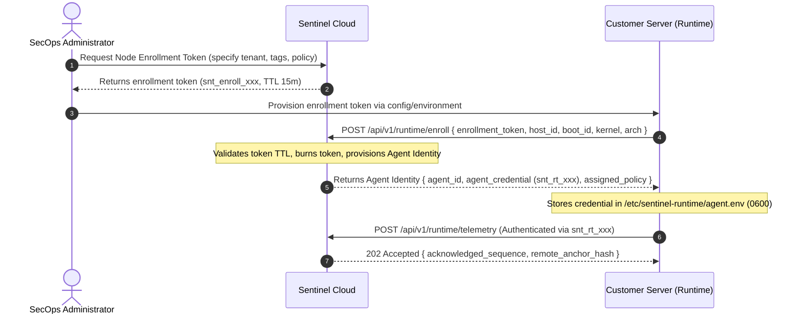

# Sentinel Cloud & Runtime Integration Blueprint (v1)

**Document Identifier:** `SENTINEL_CLOUD_RUNTIME_INTEGRATION_BLUEPRINT_V1`  
**Status:** Approved Architectural Blueprint  
**Date:** 2026-11-08  
**Scope:** Architecture, Outbound Telemetry Protocol, Tripartite Authentication, Multi-Tenant Data Plane, and Professional Operations Workspaces for Sentinel Cloud & Sentinel Runtime.

---

## 1. Executive Summary & Vision

Sentinel Cloud is designed as an enterprise **Security Operations & Intelligence Platform** for modern infrastructure, containerized workloads, Linux hosts, and automated AI agents. It does **not** rely on conversational chatbot wrappers or synthetic persona simulations. Instead, it provides deterministic analytical engines, cross-host correlation, tamper-evident cryptographic evidence, and role-tailored analyst workbenches aligned with **NIST SP 800-61 Rev. 3** (Incident Response Recommendations and Risk Management Integration).

```
   CUSTOMER INFRASTRUCTURE (Linux / Kubernetes / Cloud Workloads)
   ┌─────────────────────────────────────────────────────────────┐
   │ Host Node A                   Host Node B                   │
   │ ┌──────────────────────┐      ┌──────────────────────┐      │
   │ │ Cilium Tetragon eBPF │      │ Cilium Tetragon eBPF │      │
   │ │         │            │      │         │            │      │
   │ │         ▼            │      │         ▼            │      │
   │ │ Sentinel Runtime     │      │ Sentinel Runtime     │      │
   │ │ (FSM/CEP Engine +    │      │ (FSM/CEP Engine +    │      │
   │ │  Local SQLite Ledger)│      │  Local SQLite Ledger)│      │
   │ └──────────┬───────────┘      └──────────┬───────────┘      │
   └────────────┼─────────────────────────────┼──────────────────┘
                │                             │
                │ Outbound TLS/mTLS           │ Outbound TLS/mTLS
                │ (Node-Scoped Agent Key)     │ (Node-Scoped Agent Key)
                ▼                             ▼
   ┌─────────────────────────────────────────────────────────────┐
   │                       SENTINEL CLOUD                        │
   │               Telemetry Ingestion Gateway                   │
   │       ┌──────────────────────────────────────────────┐      │
   │       │ Multi-Tenant Partitioning & Deduplication    │      │
   │       └──────────────────────┬───────────────────────┘      │
   │                              │                              │
   │               Central Intelligence Engines                  │
   │       ┌──────────────────────────────────────────────┐      │
   │       │ • Cross-Host Causal Correlation Engine       │      │
   │       │ • Fleet Behavioral Baseline & Risk Engine    │      │
   │       │ • Threat Intelligence Enrichment             │      │
   │       │ • Evidence Integrity & Anchoring Vault       │      │
   │       └──────────────────────┬───────────────────────┘      │
   │                              │                              │
   │               Security Operations Workbenches               │
   │  ┌───────────────┬────────────────┬──────────────────────┐  │
   │  │  SOC Analyst  │  Detection Eng │    DFIR Workbench    │  │
   │  │   Workbench   │   Workbench    │  (Forensic Timeline) │  │
   │  └───────────────┴────────────────┴──────────────────────┘  │
   └─────────────────────────────────────────────────────────────┘
```

### Core Architecture Principles

1. **Host-Side Edge Detection vs. Cloud-Side Correlation:**
   Sentinel Runtime detects immediate malicious sequences at microsecond latency on the host kernel. Sentinel Cloud correlates events across multiple hosts, clusters, identity providers, and cloud control planes.
2. **Reverse Outbound Architecture:**
   Customer nodes never expose open network listeners or SSH ports to Sentinel Cloud. Sentinel Runtime initiates all connections outbound over authenticated HTTPS/mTLS.
3. **Deterministic Integrity:**
   All alerts and incident groups are backed by verifiable source event keys and cryptographic SHA-256 ledger checkpoints.

---

## 2. Tripartite Credential & Enrollment Lifecycle

To prevent credential theft on a compromised host from pivoting across an organization, Sentinel enforces three strictly separated credential tiers:

```
┌──────────────────────────────────────────────────────────────────────────┐
│                             CREDENTIAL TIERS                             │
├──────────────────────┬─────────────────────────┬─────────────────────────┤
│ 1. Enrollment Token  │ 2. Agent Credential     │ 3. Customer API Key     │
│ (Registration Only)  │ (Outbound Telemetry)    │ (SecOps Console / SIEM) │
├──────────────────────┼─────────────────────────┼─────────────────────────┤
│ • Issued by Cloud    │ • Issued to one host    │ • Issued to analysts    │
│ • Single-use         │ • Scoped: tenant+host   │ • Scoped: RBAC roles    │
│ • 15-minute TTL      │ • Zero admin scopes     │ • Never sent to nodes   │
│ • No telemetry scope │ • Revocable per host    │ • Management only       │
└──────────────────────┴─────────────────────────┴─────────────────────────┘
```

### Step-by-Step Enrollment Protocol



### Security Boundary Invariant
If an attacker attains full root access on a customer host and extracts `snt_rt_xxx`:
- The attacker **cannot** read telemetry from other hosts.
- The attacker **cannot** alter global detection policies.
- The attacker **cannot** access Cloud administrative APIs.
- The administrator can immediately revoke that specific `agent_id` from the Cloud Console without rotating credentials across the rest of the fleet.

---

## 3. Telemetry Egress & Ingestion Contract

### 3.1 What is Transmitted vs. Strictly Excluded

| Category | Transmitted to Sentinel Cloud | Excluded by Default (Privacy Invariant) |
|---|---|---|
| **Identity** | `tenant_id`, `host_id`, `boot_id`, `agent_id`, `exec_id`, `pid`, `ppid` | Host machine passwords, local private keys, user home paths |
| **Processes** | Binary path, binary SHA-256 (if enabled), exit code, parent comm | Process environment variables (`$DATABASE_URL`, `$API_KEY`, etc.) |
| **Command Line** | Redacted by default; captured only if `--capture-process-arguments` enabled | Unredacted password flags (`--password=secret`), authorization headers |
| **Security Signals** | Detection type (`SUSPICIOUS_EXFILTRATION_SEQUENCE`), severity, confidence, rule ID | Full disk file payloads, memory dumps, decrypted TLS packet contents |
| **Observability** | Stream gap states (`GAP_ACKNOWLEDGED`), drop counts, queue depth | Unrelated system logs, non-security kernel debug messages |
| **Evidence** | Checkpoint SHA-256 hashes, batch sequence numbers, source event keys | Entire SQLite raw database file (only exported via explicit custody bundle) |

### 3.2 Ingestion API Endpoint Specification

#### `POST /api/v1/runtime/telemetry`
**Headers:**
- `Authorization: Bearer snt_rt_<tenant>_<node>`
- `Content-Type: application/json`
- `X-Sentinel-Agent-Version: 0.1.0`
- `X-Sentinel-Contract-Version: 2.0.0`

**Payload Schema:**
```json
{
  "agent_id": "agt_01j7x49b2m8q",
  "host_id": "prod-api-worker-04",
  "boot_id": "7d9b4c2e-81f3-4a65-b1a9-d3e2a7f50b81",
  "batch_sequence": 1420,
  "checkpoint_hash": "e3b0c44298fc1c149afbf4c8996fb92427ae41e4649b934ca495991b7852b855",
  "observability_state": "HEALTHY",
  "events": [
    {
      "source_event_key": "raw:tetragon:v1:7d9b4c2e:1420:12",
      "timestamp": "2026-11-08T01:30:00.124Z",
      "event_type": "PROCESS_EXEC",
      "process_identity": {
        "exec_id": "exec_8fa21c90",
        "pid": 4812,
        "ppid": 1201,
        "binary_path": "/usr/bin/curl"
      },
      "decision": {
        "requested_action": "OBSERVE_ONLY",
        "severity": "HIGH",
        "confidence": 0.85,
        "rule_matches": ["SUSPICIOUS_EXFILTRATION_SEQUENCE"],
        "safety_gating": []
      }
    }
  ]
}
```

**Response (`202 Accepted`):**
```json
{
  "status": "ACCEPTED",
  "acknowledged_batch": 1420,
  "ledger_anchor_status": "COMMITTED",
  "policy_version": "v1.4.2"
}
```

### 3.3 Disconnect & Telemetry Loss Handling
If the egress connection drops:
1. Sentinel Runtime buffers records in its local SQLite transaction queue.
2. If local memory or disk caps are approached, backpressure is managed locally; the kernel sensor is never throttled to prevent dropping events.
3. When connectivity restores, Sentinel Runtime transmits the buffered batches in chronological sequence order.
4. If an unrecoverable gap occurred, the agent emits an explicit `GAP_ACKNOWLEDGED` event with loss metrics.

---

## 4. Multi-Tenant Isolation & Storage Architecture

```
                    SENTINEL CLOUD DATA PLANE
┌─────────────────────────────────────────────────────────────────┐
│                      TENANT PARTITIONING                        │
│                                                                 │
│ ┌─────────────────────────┐         ┌─────────────────────────┐ │
│ │ Tenant: Enterprise Alpha│         │ Tenant: Fintech Beta    │ │
│ ├─────────────────────────┤         ├─────────────────────────┤ │
│ │ • PostgreSQL RLS Schema │         │ • PostgreSQL RLS Schema │ │
│ │ • Fleet Key: KMS Key A  │         │ • Fleet Key: KMS Key B  │ │
│ │ • 142 Monitored Hosts   │         │ • 38 Monitored Hosts    │ │
│ │ • Isolated ClickHouse   │         │ • Isolated ClickHouse   │ │
│ │   Partition             │         │   Partition             │ │
│ └─────────────────────────┘         └─────────────────────────┘ │
└─────────────────────────────────────────────────────────────────┘
```

1. **Row-Level Security (RLS) & Partitioning:**
   Every database query enforces `tenant_id` at the database layer (PostgreSQL Row-Level Security for transactional data; dedicated tenant partition keys in ClickHouse for high-volume telemetry analytics).
2. **KMS-Managed Per-Tenant Keys:**
   Telemetry digests and forensic anchor bundles are signed and encrypted with tenant-specific AWS KMS or HashiCorp Vault transit keys.
3. **Strict Zero Cross-Tenant Querying:**
   No API endpoint or analytical job can cross tenant boundaries. Aggregated global threat intelligence uses anonymized, de-identified IoC signatures with differential privacy.

---

## 5. Operations Console: Professional Workspaces

Rather than a generic chat bot, Sentinel Cloud organizes security workflows into specialized, role-tailored workbenches:

```
┌────────────────────────────────────────────────────────────────────────┐
│                   SENTINEL SECURITY OPERATIONS CONSOLE                 │
├────────────────────┬───────────────────────────────────────────────────┤
│ 01. Command Center │ Fleet Health, Coverage Gaps, Severity Summary     │
│ 02. Fleet & Assets │ Host Nodes, Kernels, Tetragon Status, Agent Keys  │
│ 03. Detection Ctr  │ Triage Queue, Alert Frequencies, True/False Pos.  │
│ 04. Investigation  │ Cross-Host Process Lineage, Causal Event Graph    │
│ 05. DFIR Forensic  │ Cryptographic Ledgers, Hash Chains, Bundle Export │
│ 06. Incident Resp. │ Playbooks, Case Management, Human Approvals (R2)  │
│ 07. Detection Eng. │ Rule Tuning, Workload Baselines, Regression Tests │
│ 08. Administration │ Multi-Tenant IAM, Enrollment Tokens, API Keys     │
└────────────────────┴───────────────────────────────────────────────────┘
```

### 5.1 SOC Analyst Workbench
- **Triage Queue:** Real-time priority inbox classified by severity (`CRITICAL`, `HIGH`, `MEDIUM`, `LOW`) and confidence score.
- **Context Card:** For every alert, surfaces the exact host identity, kernel boot ID, process execution tree, network destination, and triggering rule.
- **One-Click Actions:** Suppress benign pattern (creates tuning candidate for Security Engineer), escalate to Incident Case, or request host isolation approval.

### 5.2 Security / Detection Engineer Workbench
- **Policy Management:** Version-controlled YAML policies deploying `WorkloadProfile` rules to agent fleets.
- **Baseline Tuning:** Analyzes observed process and network deviations to calibrate EWMA/CUSUM anomaly detection thresholds.
- **Regression Simulator:** Replays historical event batches against candidate rules to calculate false-positive rates before fleet deployment.

### 5.3 DFIR & Forensic Workbench
- **Causal Execution Timeline:** Chronological timeline linking `PROCESS_EXEC`, `VFS_READ`, and `TCP_CONNECT` events across multiple nodes.
- **Ledger Verification Tool:** Verifies the cryptographic SHA-256 hash chain of any node's SQLite database directly from cloud anchors.
- **Verifiable Bundle Downloader:** Generates HMAC-signed custody bundles adhering to RFC-compliant forensic formats.

### 5.4 Incident Responder Workbench
- **Case Management:** Coordinates containment actions across multiple systems under NIST SP 800-61 Rev. 3 guidelines.
- **Human Approval Gate:** Any R2 (Process Suspension) recommendation requires two-party authorization in the console. Active R3/R4 containment remains locked out until production validation gates are satisfied.

---

## 6. Analytical Engines Architecture

Decisions in Sentinel Cloud are generated by specialized deterministic engines:

```
                         SENTINEL CLOUD ENGINES
┌──────────────────────┬─────────────────────────────────────────────────┐
│ Engine               │ Responsibility                                  │
├──────────────────────┼─────────────────────────────────────────────────┤
│ Event Intelligence   │ Normalizes Contract v2 schemas; drops malformed │
│ Behavioral Detection │ FSM/CEP sequence matching & statistical drifts  │
│ Causal Correlation   │ Maps multi-host process & network lineage trees │
│ Threat Intelligence  │ Matches external IoCs (C2 IPs, known bad SHA256)│
│ Risk Engine          │ Scores incident severity based on asset value   │
│ Evidence Integrity   │ Validates tamper-evident SQLite hash chains     │
│ Response Policy      │ Enforces strict gating before response actions  │
└──────────────────────┴─────────────────────────────────────────────────┘
```

---

## 7. Commercial Release & Production Readiness Criteria

Sentinel Runtime and Sentinel Cloud will achieve general commercial release only when the following criteria are completed:

- [x] **F5-R1-R1 Semantics:** `OPERATOR_ACK` strictly segregated from `SENSOR_REPLAY_VERIFIED`.
- [x] **Local Observe-Only Gating:** `autoContain=false` and `dryRun=true` permanently default.
- [ ] **F6 Process Identity Resolution:** Pre-restart process continuity verified without synthetic PID collapse.
- [ ] **Native Linux Sensor Validation (L3-N):** Automated validation across Ubuntu, RHEL, and Debian production kernels.
- [ ] **Sentinel Cloud Ingestion Gateway (Phase 1):** Reverse outbound ingestion endpoint with dynamic enrollment tokens.
- [ ] **External Ledger Anchoring:** Periodic cryptographic anchoring of host SQLite heads into Sentinel Cloud Vault.
- [ ] **Active Containment Qualification:** End-to-end qualification of R2 suspension and R3 termination before enabling live action switches.

---

## 8. Summary of Non-Goals

1. **No Inbound Node Access:** Sentinel Cloud will never require SSH credentials or open inbound ingress ports on customer servers.
2. **No LLM in the Fast Decision Path:** No language model will evaluate kernel syscalls or make live containment decisions. All detection and containment gates remain 100% deterministic, auditable, and mathematical.
3. **No Unredacted Data Ingestion:** Sentinel Cloud will never ingest raw customer database contents, file systems, or environment variables.
