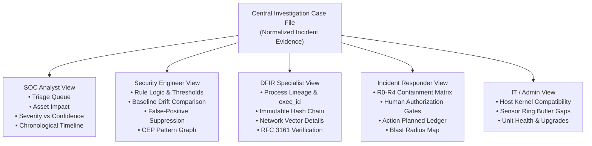

# Sentinel Cloud — Security Operations & Incident Intelligence UX Specification (v2)

**Document ID:** `SENTINEL_CLOUD_SECURITY_OPERATIONS_UX_V2`  
**Revision:** `2.0.0-PROPOSAL`  
**Status:** `RFC / PROPOSED FOR ARCHITECTURAL REVIEW`  
**Author:** Sentinel Systems Engineering & UX Architecture  
**Target Milestone:** Sentinel Cloud Enterprise Runtime Experience  
**Date:** November 2026  

---

## 1. Executive Vision: From Telemetry Viewer to Intelligence Platform

### 1.1 The Core Problem with Telemetry-First UIs
Early iterations of security interfaces treat the database record as the presentation layer. When a customer pays for an Enterprise security platform, deploys Sentinel Runtime to their Linux servers, and receives an alert, delivering a raw JSON dump or a table of cryptographic hashes forces the customer to do the work that the product was bought to automate.

A raw JSON payload:
```json
{
  "process": { "binary": "/usr/bin/curl", "pid": 10420 },
  "detection": "SUSPICIOUS_NETWORK_AND_SHELL_SEQUENCE",
  "containment": { "mode": "OBSERVE_ONLY" }
}
```
presents raw facts without intelligence. It fails to answer the executive, operational, or defensive questions that a human operator must answer immediately:
1. **What happened?** (Plain-language behavioral description)
2. **Why did Sentinel flag it?** (Exact condition that crossed the baseline)
3. **What systems are affected?** (Host identity, environment, workload role)
4. **What is verified vs unconfirmed?** (Strict boundary between observed facts and speculative threat narratives)
5. **What is the blast radius?** (Did the process touch other files, spawn child shells, or move laterally?)
6. **What should be done now?** (Actionable response options under safety gates)

### 1.2 The Paradigm Shift
Sentinel Cloud UX v2 abandons the "telemetry inspector" model and establishes a **Universal Security Operations & Investigation Platform**.
- **The Case File is the Primary Entity:** Every detection is encapsulated into a structured **Investigation Case File**.
- **Tiered Information Architecture:** Four progressive layers of depth serve everyone from a CTO to a DFIR specialist without fragmenting into disconnected tools.
- **Epistemic Honesty:** The UI strictly separates `OBSERVED` facts from `DERIVED` conclusions and `UNKNOWN` variables. Sentinel never invents malicious narratives that the telemetry cannot substantiate.
- **Raw Data Preserved:** The original eBPF event stream and structured JSON envelope remain instantly accessible as secondary forensic evidence, complete with search, diff, and export tools.

---

## 2. The Universal Investigation Model: 4 Tiers of Knowledge

Every incident rendered in Sentinel Cloud presents four collapsible, interconnected tiers of depth:

```
┌────────────────────────────────────────────────────────────────────────┐
│ TIER 1: EXECUTIVE & OPERATIONAL SUMMARY                                │
│ Plain-language summary, asset risk, severity vs confidence, blast      │
│ radius, active containment posture (OBSERVE_ONLY).                     │
├────────────────────────────────────────────────────────────────────────┤
│ TIER 2: SECURITY INVESTIGATION (BEHAVIORAL CONTEXT)                    │
│ • Visual chronological execution & network timeline (microsecond delta)│
│ • Process causality tree (verified parentage vs unproven sockets)      │
│ • Network vector card (outbound flow, destination context, Tor flag)   │
│ • "Why Sentinel Flagged This" (normative rule activation conditions)   │
│ • Epistemic boundary: "What We Know" vs "What Remains Unconfirmed"     │
├────────────────────────────────────────────────────────────────────────┤
│ TIER 3: TECHNICAL EVIDENCE & PROVENANCE                                │
│ • Exact process identities: host_id, boot_id, exec_id, pid, ppid, tid  │
│ • Sensor health & coverage at event time (Tetragon loss counters)      │
│ • SHA-256 digest computation & local SQLite ledger chain state         │
│ • RFC 3161 TSA Token status (explicitly distinguishing computed local   │
│   digest from third-party authority timestamping)                      │
├────────────────────────────────────────────────────────────────────────┤
│ TIER 4: RAW FORENSIC DATA & EXPORT                                     │
│ • Complete sanitized JSON envelope with syntax highlighting            │
│ • Hex/hash verification strings                                        │
│ • One-click JSON / STIX 2.1 export                                     │
└────────────────────────────────────────────────────────────────────────┘
```

---

## 3. Epistemic Invariant: Distinguishing Facts from Inferences

A critical flaw in modern EDR tools is presenting speculative inferences as established facts. Sentinel Cloud enforces normative status badges across all investigation cards:

| Badge | Semantic Definition | Example in UI |
|---|---|---|
| `OBSERVED` | Directly recorded by kernel sensor (Tetragon eBPF kprobe/tracepoint) with high-fidelity identity. | Execution of `/usr/bin/curl` with PID 10420 at UTC timestamp. |
| `DERIVED` | Inferred by correlation engine across multiple observed events within a temporal window. | Correlation of network outbound packet (+42 ms) with child bash spawn (+115 ms). |
| `UNKNOWN` | Telemetry domain was not configured, sensor dropped packets, or event occurred outside visibility. | Socket descriptor inheritance between network client and interpreter (not proven by tracepoints). |
| `PARTIALLY_ATTRIBUTED` | Event is observed, but parentage or cryptographic binary hash cannot be verified. | Process spawned from recycled PID before collector initialized. |
| `VERIFIED` | Cryptographically signed, ledger-committed, and immutable against local tamper. | Action planned record committed to SQLite prior to containment dispatch. |

### Concrete Epistemic Boundary Card in Investigation View
```
┌──────────────────────────────────────────────────────────────────────────────────┐
│ EPISTEMIC AUDIT // FACTUAL ASSESSMENT BOUNDARY                                  │
├───────────────────────────────────────────────────┬──────────────────────────────┤
│ WHAT WE KNOW (OBSERVED & VERIFIED)                │ WHAT REMAINS UNCONFIRMED     │
├───────────────────────────────────────────────────┼──────────────────────────────┤
│ • Process /usr/bin/curl executed by UID 1000      │ • Payload download volume:   │
│ • TCP connection established to 185.220.101.5:443 │   Byte stream not buffered   │
│ • Process /bin/bash spawned +115ms later          │ • Socket inheritance:        │
│ • Destination IP is an active Tor exit node       │   Direct pipe not proven     │
│ • autoContain=false; no process was suspended     │ • Disk persistence:          │
│                                                   │   No file writes detected    │
└───────────────────────────────────────────────────┴──────────────────────────────┘
```

---

## 4. One Central Investigation, Multiple Operational Perspectives

Rather than fragmenting Sentinel into five separate products, a single Investigation Case File adapts its controls and tooling based on user role:



---

## 5. Screen Wireframes & UX Workflows

### 5.1 Screen 1: Tactical Command Center (`/dashboard/runtime`)
The home screen moves beyond passive metric tiles. It prioritizes **what needs operational attention**, **infrastructure coverage gaps**, and **active host integrity**.

```
┌────────────────────────────────────────────────────────────────────────────────────────────────────────┐
│ SENTINEL CLOUD // RUNTIME OPERATIONS CENTER                             [ENTERPRISE]  [↻ SYNC]  [+ ENROLL]│
├────────────────────────────────────────────────────────────────────────────────────────────────────────┤
│ ATTENTION REQUIRED (2)                                                                                 │
│ ┌────────────────────────────────────────────────────────────────────────────────────────────────────┐ │
│ │ 🚨 CRITICAL · SUSPICIOUS_NETWORK_AND_SHELL_SEQUENCE · Host: prod-api-01 · +14m ago · [INVESTIGATE →] │ │
│ │ ⚠️  WARNING  · TELEMETRY_OBSERVABILITY_GAP · Host: staging-worker-02 · Ring Buffer Drop · [RESOLVE →]│ │
│ └────────────────────────────────────────────────────────────────────────────────────────────────────┘ │
├────────────────────────────────────────────────────────────────────────────────────────────────────────┤
│ FLEET HEALTH & SENSOR COVERAGE                                                                        │
│ ┌───────────────────┐ ┌───────────────────┐ ┌───────────────────┐ ┌───────────────────┐               │
│ │ ENROLLED HOSTS    │ │ SENSOR HEALTH     │ │ QUOTA USAGE       │ │ INTEGRITY POSTURE │               │
│ │ 1 / 25 Registered │ │ 1 Healthy         │ │ 24 Slots Available│ │ SHA-256 Pinned    │               │
│ │ 1 Active Streaming│ │ 0 Degraded Gaps   │ │ Enterprise Annual │ │ Local Chain Valid │               │
│ └───────────────────┘ └───────────────────┘ └───────────────────┘ └───────────────────┘               │
├────────────────────────────────────────────────────────────────────────────────────────────────────────┤
│ ACTIVE INVESTIGATIONS (INCIDENTS)                                        Filter: [All] [Critical] [Open]│
│ ┌───────────────┬────────────┬─────────────┬───────────┬──────────────┬───────────────┬──────────────────┐ │
│ │ TIMESTAMP     │ ASSET      │ RULE        │ SEVERITY  │ CONFIDENCE   │ CONTAINMENT   │ ACTIONS          │ │
│ ├───────────────┼────────────┼─────────────┼───────────┼──────────────┼───────────────┼──────────────────┤ │
│ │ 08:44:23 UTC  │ pruebas    │ NET_SHELL   │ CRITICAL  │ PARTIAL (CEP)│ OBSERVE_ONLY  │ [OPEN CASE →]    │ │
│ │ 08:39:32 UTC  │ pruebas    │ NET_SHELL   │ CRITICAL  │ SYNTHETIC    │ OBSERVE_ONLY  │ [OPEN CASE →]    │ │
│ └───────────────┴────────────┴─────────────┴───────────┴──────────────┴───────────────┴──────────────────┘ │
├────────────────────────────────────────────────────────────────────────────────────────────────────────┤
│ ENROLLED HOST NODES                                                      [Manage Hosts] [Download Config]│
│ ┌───────────────┬────────────────────┬──────────────┬──────────────────┬──────────────┬──────────────────┐ │
│ │ DEVICE NAME   │ SENSOR KERNEL      │ AGENT OS     │ SENSOR VERSION   │ STATUS       │ ACTIONS          │ │
│ ├───────────────┼────────────────────┼──────────────┼──────────────────┼──────────────┼──────────────────┤ │
│ │ pruebas       │ Linux 6.6.36-wsl2  │ Node.js/Win  │ Tetragon v1.8.0  │ ● HEALTHY    │ [Heartbeat] [•••]│ │
│ └───────────────┴────────────────────┴──────────────┴──────────────────┴──────────────┴──────────────────┘ │
└────────────────────────────────────────────────────────────────────────────────────────────────────────┘
```

---

### 5.2 Screen 2: Unified Investigation Case File (`/dashboard/runtime/investigations/[id]`)
When an analyst clicks `[OPEN CASE →]`, they are presented with an exhaustive forensic dossier, not a JSON dialog.

```
┌────────────────────────────────────────────────────────────────────────────────────────────────────────┐
│ CASE #INC-1794127464 · INVESTIGATION DOSSIER                                        [EXPORT] [CLOSE ✕] │
├────────────────────────────────────────────────────────────────────────────────────────────────────────┤
│ [SEVERITY: CRITICAL] [CONFIDENCE: PARTIAL / OBSERVED SEQUENCE] [CONTAINMENT: R1 OBSERVE_ONLY (dryRun)] │
│                                                                                                        │
│ Suspicious Network-to-Shell Sequence Detected                                                          │
│ An outbound network connection was established by curl, followed by immediate interactive shell spawn. │
│ Asset Affected: pruebas (Staging Linux / WSL2) · Triggered by Workload UID 1000 · 08:44:23 UTC        │
├────────────────────────────────────────────────────────────────────────────────────────────────────────┤
│ NAVIGATION TABS: [1. Executive Summary] [2. Investigation Tree] [3. Evidence & Proof] [4. Raw Telemetry]│
├────────────────────────────────────────────────────────────────────────────────────────────────────────┤
│ [TAB 2: INVESTIGATION TREE ACTIVE]                                                                    │
│                                                                                                        │
│ VISUAL CHRONOLOGICAL TIMELINE                                                                          │
│  T+000ms   ● PROCESS_EXEC     /usr/bin/curl (PID 10420, PPID 10400) by UID 1000                        │
│            │                                                                                          │
│  T+042ms   ● NETWORK_CONNECT  TCP SYN Outbound ➔ 185.220.101.5:443 [TOR EXIT NODE ⚠️]                 │
│            │                                                                                          │
│  T+115ms   ● PROCESS_EXEC     /bin/bash (PID 10425, PPID 10420)                                        │
│                                                                                                        │
│ WHY SENTINEL FLAGGED THIS:                                                                             │
│ Sequence Rule 'SUSPICIOUS_NETWORK_AND_SHELL_SEQUENCE' triggered: process spawned interactive shell     │
│ within 115ms (< 500ms window) of opening an outbound TCP socket to an unclassified foreign address.   │
│                                                                                                        │
│ PROCESS CAUSALITY & RELATIONSHIPS:                                                                     │
│  python3 (PID 10400) ➔ curl (PID 10420) ➔ bash (PID 10425)                                            │
│  [OBSERVED: verified via Tetragon kprobe exec_id linkage]                                              │
│                                                                                                        │
│ NETWORK VECTOR ANALYSIS:                                                                               │
│  Destination: 185.220.101.5:443 · Reverse DNS: tor-exit-node-04.net · AbuseIPDB Score: 87%            │
│  Classification: Known public Tor exit router. Outbound tunnel or reverse-shell staging suspected.    │
│                                                                                                        │
│ WHAT WE DO NOT KNOW (EPISTEMIC LIMITS):                                                                │
│  - Payload bytes transferred: Not captured (payload buffering disabled by privacy policy).            │
│  - Socket descriptor inheritance: Not conclusively demonstrated in event contract v1.                │
├────────────────────────────────────────────────────────────────────────────────────────────────────────┤
│ [TAB 3: EVIDENCE & PROOF PREVIEW]                                                                      │
│  Local SHA-256 Digest: e80b834190d33963941b5cdcaff9719928bdd622b905f0ccba0bb74f21b321f0 [COMPUTED]   │
│  Local SQLite Ledger Chain: Block #1402 [CHAIN INTEGRITY VALIDATED]                                    │
│  RFC 3161 Timestamp Token: [NOT ANCHORED] Local machine clock used. External TSA anchoring inactive.   │
├────────────────────────────────────────────────────────────────────────────────────────────────────────┤
│ [TAB 4: RAW TELEMETRY JSON PREVIEW] (Expandable / Searchable)                                           │
│  [Copy JSON] [Download STIX 2.1] [View Protobuf Schema]                                               │
│  { "detection": "SUSPICIOUS_NETWORK_AND_SHELL_SEQUENCE", "process": { "pid": 10420, ... } }            │
└────────────────────────────────────────────────────────────────────────────────────────────────────────┘
```

---

## 6. Host Identity & Metric Calculation Architecture

### 6.1 OS and Kernel Separation Schema
To prevent confusing host runtime environments (such as Node.js running on Windows while monitoring WSL2 Linux), the host record explicitly separates:

```typescript
interface RuntimeHostIdentity {
  // Agent Execution Environment (where the daemon process runs)
  agent_runtime: {
    platform: 'win32' | 'linux' | 'darwin';
    os_release: string; // e.g. "10.0.26200"
    arch: string;       // e.g. "x64"
    node_version: string;
    daemon_version: string;
  };

  // Sensor Workload Environment (where eBPF Tetragon monitors kernel syscalls)
  sensor_environment: {
    platform: 'linux';
    kernel_release: string; // e.g. "6.6.36.6-microsoft-standard-WSL2"
    kernel_arch: string;    // e.g. "x86_64"
    tetragon_version: string; // e.g. "v1.8.0"
    bpf_compat_verified: boolean;
    observability_state: 'HEALTHY' | 'GAP_DETECTED' | 'DEGRADED' | 'RECOVERED';
  };
}
```

### 6.2 Formal Metric Definitions
Every metric on the dashboard must be derived from verified database queries with unambiguous semantics:

1. **Enrolled Hosts (Registered):**
   `COUNT(*) FROM runtime_hosts WHERE organization_id = :org_id AND revoked_at IS NULL`
2. **Active Streaming Hosts:**
   `COUNT(*) FROM runtime_hosts WHERE organization_id = :org_id AND revoked_at IS NULL AND last_heartbeat_at > NOW() - INTERVAL '120 seconds'`
3. **Healthy Hosts:**
   `Active Streaming Hosts WHERE status = 'HEALTHY' AND loss_events_count = 0`
4. **Enterprise Host Quota:**
   - Total Included: `capabilities.runtimeMaxHosts` (25 for Enterprise).
   - Used: Enrolled Hosts count ($N$).
   - Available Slots: `Math.max(0, 25 - N)`.
   - Visual format: `1 / 25 used · 24 available`.
5. **Incidents vs Detections vs Envelopes:**
   - **Detection:** An individual behavioral or anomaly trigger raised by an engine rule.
   - **Incident:** A grouped security event representing a coherent attack sequence or anomaly across an actor or workload. Multiple detections correlate into a single Incident.
   - **Evidence Envelope:** The immutable, serialized cryptographic container submitted by the runtime agent containing the telemetry, hashes, and context of an incident.

---

## 7. Tripartite Credential Governance & Compromise Handling

### 7.1 Separation of Credential Scopes
```
┌────────────────────────────────────────────────────────────────────────┐
│ 1. CUSTOMER API KEY (snt_live_...)                                     │
│ Scope: Web console, programmatic report extraction, billing, CI scan.  │
│ Auth: Bearer token in HTTP header. Never placed on Linux runtime host. │
├────────────────────────────────────────────────────────────────────────┤
│ 2. HOST ENROLLMENT TOKEN (snt_enroll_...)                              │
│ Scope: Temporary (1-hour TTL) single-use token to enroll a new server. │
│ Auth: Exchanged during daemon installation for an Agent Credential.   │
├────────────────────────────────────────────────────────────────────────┤
│ 3. RUNTIME AGENT CREDENTIAL (snt_rt_...)                               │
│ Scope: Strictly restricted to POST /api/runtime/heartbeat and          │
│        POST /api/runtime/incidents. Cannot read data or bill accounts. │
│ Storage: SHA-256 hashed in database. Raw key shown once at generation.│
└────────────────────────────────────────────────────────────────────────┘
```

### 7.2 Compromise Invariant (Prioridad 0 Compliance)
When any `snt_rt_` credential appears in plaintext logs, prompts, or public channels:
1. **Immediate Server-Side Revocation:** The host status is set to `REVOKED` and `revoked_at` is stamped in `runtime_hosts`.
2. **Deterministic Rejection:** Subsequent requests using the token receive HTTP 401 `Invalid or revoked runtime token`.
3. **Agent Clean-Up:** Source code, configuration templates, and test scripts must strictly reference `process.env.SENTINEL_RUNTIME_API_KEY` and never embed static token strings.

---

## 8. Verification & Acceptance Criteria

| ID | Capability | Acceptance Verification Standard |
|---|---|---|
| **AC-01** | Zero-Ambiguity Investigation View | Clicking any incident opens a 4-tier Case File. Executive summary is fully readable without viewing JSON. |
| **AC-02** | Epistemic Boundary Enforcement | Every investigation explicitly lists "What We Know" vs "What Remains Unconfirmed". No speculative malware claims. |
| **AC-03** | Epistemic Integrity of Hashes | UI displays "SHA-256 Digest: Computed". Does not claim RFC 3161 unless a verified TSA TimeStampToken is attached. |
| **AC-04** | Accurate Kernel Identity | UI displays both Agent Runtime OS (`Node.js on Windows_NT`) and Sensor Host Kernel (`Linux 6.6.36-wsl2`). Never labels Windows builds as Linux kernels. |
| **AC-05** | Metric Consistency | Dashboard metrics match database counts exactly: 1 host registered displays as `1 / 25 used · 24 available`. Active and healthy statuses match recent heartbeat timestamps. |
| **AC-06** | Full Raw Telemetry Retention | The complete sanitized JSON envelope is preserved in Tier 4 with syntax highlighting, search, and one-click clipboard copy. |
| **AC-07** | Strict Safety Gating | UI indicates `autoContain=false` and `OBSERVE_ONLY`. No automated destructive containment can be triggered without explicit human authorization. |

---

## 9. Implementation Roadmap

### Phase 1: UX Specification & Architecture Alignment (Current Milestone)
- Document `SENTINEL_CLOUD_SECURITY_OPERATIONS_UX_V2.md` in repository.
- Revoke compromised test tokens and enforce clean environment variable ingestion.
- Align on data models for `InvestigationCaseFile` and `RuntimeHostIdentity`.

### Phase 2: Investigation Case File Component Architecture
- Build `InvestigationCaseFileModal` with the 4 tabs: Executive Summary, Investigation Tree, Technical Evidence, Raw Data.
- Implement visual chronological timeline and network vector breakdown cards.
- Add epistemic audit boundary component (`WhatWeKnowCard`).

### Phase 3: Dashboard Consistency & Metric Realignment
- Update metric calculations to reflect true database states (Active/Healthy based on 120s heartbeat).
- Implement explicit host identity splitting (`agent_runtime` vs `sensor_environment`).
- Clean up quota and envelope counters.

### Phase 4: Live Tetragon Integration & E2E Validation
- Connect live WSL2/Ubuntu Tetragon gRPC stream with verifiable event identities (`exec_id`, `boot_id`).
- Demonstrate end-to-end provenance from kernel event to Sentinel Cloud Case File.
