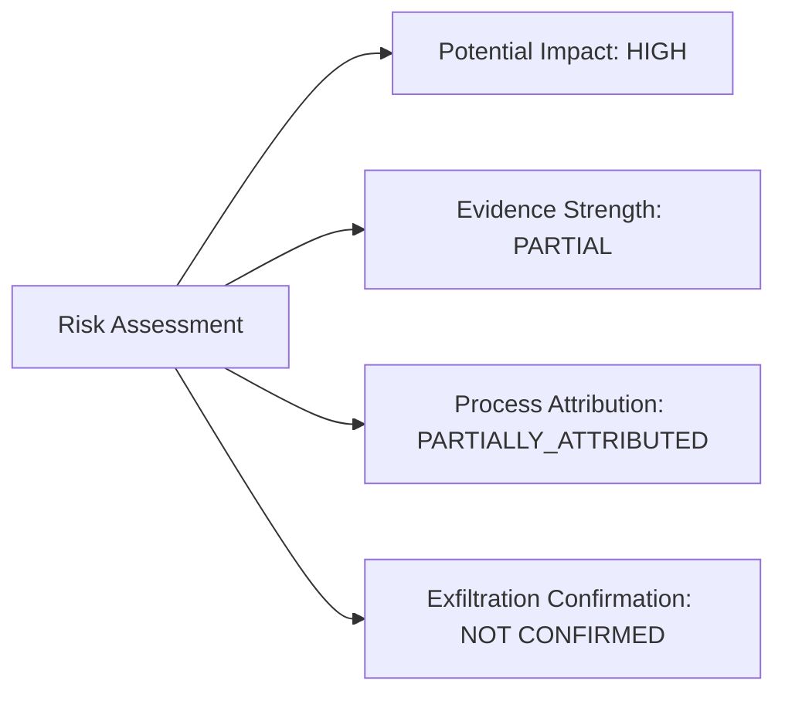
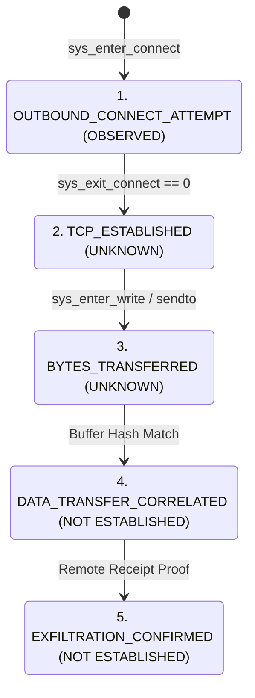
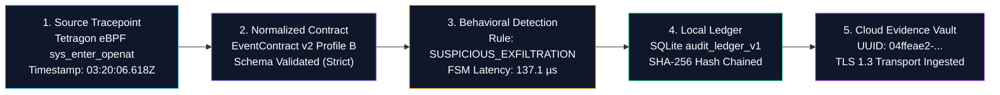
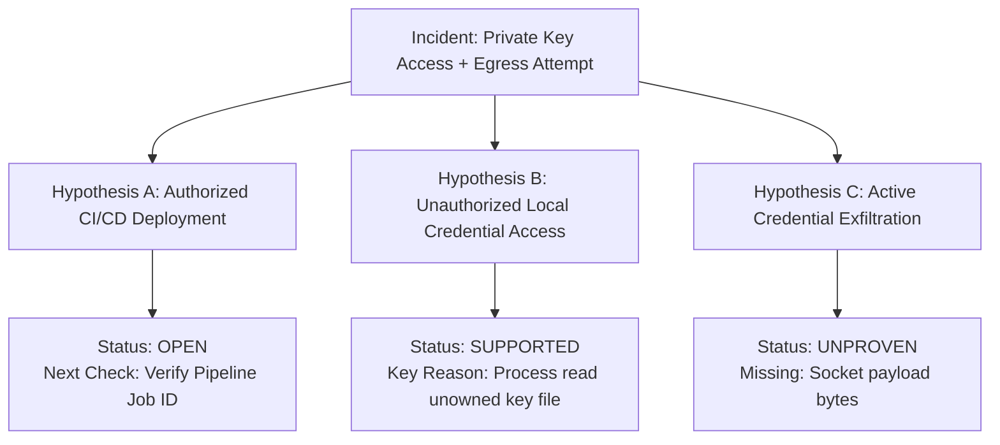

# Sentinel Incident Investigation UX & Forensic Architecture Specification (V3)
**Document ID:** SPEC-SOC-UX-V3  
**Status:** DRAFT / PENDING REVIEW (NON-COMMITTED)  
**Target:** Sentinel Cloud Operations Console & Sentinel Runtime Universal Case File  
**Author:** Sentinel Architecture & Security Engineering Team  
**Standards Alignment:** ISO/IEC 27035-1/2:2023, ISO/IEC 27037:2012, ISO/IEC 27042:2015, NIST SP 800-61 Rev. 3, RFC 5737, RFC 3161, MITRE ATT&CK v15  

---

## 1. Executive Summary & Problem Statement

### 1.1 Context
In Phase V2, Sentinel Cloud successfully integrated real-time behavioral telemetry ingested from Sentinel Runtime Linux agents, implementing an initial 4-Tier modal case file and basic synthetic scenario labeling. However, technical DFIR evaluations revealed significant gaps in evidentiary rigor:
1. **Inferential Over-Claiming:** An event sequence consisting of `PROCESS_EXEC` $\to$ `FILE_READ` $\to$ `NETWORK_CONNECT` was titled "SSH Key Theft & Tunneling", and a destination IP in RFC 5737 (`203.0.113.50`) was misclassified as an "External C2".
2. **Ambiguous Process Attribution:** Attribution relied solely on volatile `pid:13400`, vulnerable to Linux PID recycling and namespace collision.
3. **Uncalibrated Confidence Metrics:** Arbitrary static scores (e.g. "70% Confidence") were displayed without a transparent calibration baseline.
4. **Conflation of Diagnostic Latency with Incident Evidence:** Sub-millisecond FSM evaluation benchmarks ($185\,\mu\text{s}$) were positioned in incident evidence rather than isolated performance diagnostics.
5. **Lack of Hypothesis-Driven Investigation:** The interface acted as a static alert/JSON viewer rather than an interactive investigative workbench capable of testing competing forensic hypotheses (e.g. Authorized CI/CD pipeline vs Adversarial Credential Exposure).

### 1.2 Objective
Specification V3 transitions Sentinel from an alert-triage viewer into a **normative, hypothesis-driven, verifiable DFIR investigation platform**. Every conclusion must trace directly to a verified kernel tracepoint, unobserved steps must be explicitly labeled as `UNKNOWN`, and competing operational hypotheses must be formally modeled and tested.

---

## 2. Normative Lexicon & Semantic Corrections

### 2.1 Destination Classification & RFC 5737 Standard
Under no circumstances may an IP within reserved documentation ranges be labeled as an external adversary or Command-and-Control (C2) server.

| Subnet Range | Standard Reference | UI Classification Label | Threat Intel Status |
| :--- | :--- | :--- | :--- |
| `192.0.2.0/24` | RFC 5737 (TEST-NET-1) | `DOCUMENTATION_RESERVED_TESTNET1` | Not Applicable (Documentation Block) |
| `198.51.100.0/24` | RFC 5737 (TEST-NET-2) | `DOCUMENTATION_RESERVED_TESTNET2` | Not Applicable (Documentation Block) |
| `203.0.113.0/24` | RFC 5737 (TEST-NET-3) | `DOCUMENTATION_RESERVED_TESTNET3` | Not Applicable (Documentation Block) |
| `127.0.0.0/8`, `::1` | RFC 1122 / RFC 4291 | `HOST_LOCAL_LOOPBACK` | Internal Non-Routable |
| Public Routable IP | IANA Public Address Space | `EXTERNAL_INTERNET_DESTINATION` | External Feed Lookup (AbuseIPDB/VT) |

#### Semantics for Incident `inc_scenario_4_ssh_key_theft_1794129606672`:
- **Observed Destination:** `203.0.113.50:2222`
- **Subnet Identity:** RFC 5737 TEST-NET-3 (Example / Documentation)
- **Observed Protocol:** TCP (IPv4)
- **Service Identification:** `UNKNOWN` (Port 2222 is non-standard; cannot be assumed to be SSH without banner capture)
- **Threat Intelligence Query:** Suppressed (Querying VirusTotal or AbuseIPDB for RFC 5737 ranges is an operational error)
- **C2 Attribution:** `NOT ESTABLISHED / SYNTHETIC LAB BENCHMARK`

---

### 2.2 Incident Titling & Classification
The incident title must reflect observed behavior rather than an assumed adversarial conclusion.

- **Legacy Title (V2):** "Reconocimiento y tunelización de claves privadas SSH" (Over-claiming)
- **Corrected Title (V3):** **`Acceso observado a archivo de clave privada SSH seguido de intento de conexión saliente`**
- **Canonical Classification:** `POTENTIAL_PRIVATE_KEY_ACCESS`
- **Candidate MITRE ATT&CK Mapping:** **`T1552.004` (Unsecured Credentials: Private Keys)**
  * *Note:* Mapped solely as a behavioral correlation candidate; mapping does not establish deliberate adversarial intent. Exfiltration techniques (`T1048`, `T1041`) must **NOT** be mapped without confirmed byte exfiltration.

---

### 2.3 Formal Observation Scale (Network & File Progression)
To prevent semantic drift, the UI must strictly adhere to the standardized 6-stage telemetry state progression:

```
[1. FILE_ACCESS_OBSERVED] ──> [2. OUTBOUND_ATTEMPT] ──> [3. TCP_ESTABLISHED] 
        │                              │                       │
     Verified                       Verified                UNKNOWN
        ▼                              ▼                       ▼
[4. BYTES_TRANSFERRED]  ───> [5. DATA_CORRELATED]   ───> [6. EXFILTRATION]
        │                              │                       │
     UNKNOWN                    NOT ESTABLISHED         NOT ESTABLISHED
```

1. **`FILE_ACCESS_OBSERVED`:** Tracepoint `sys_enter_openat` or `sys_enter_read` observed on target path. The UI must distinguish between:
   * *File Open Attempt:* Descriptor requested (`flags: O_RDONLY`).
   * *File Read Executed:* Bytes returned from `sys_exit_read` ($> 0$).
2. **`OUTBOUND_CONNECT_ATTEMPT`:** Tracepoint `sys_enter_connect` observed with destination sockaddr.
3. **`TCP_ESTABLISHED`:** `UNKNOWN` (Unless `sys_exit_connect` returns 0 or TCP state transition event is recorded; never labeled "pending handshake").
4. **`BYTES_TRANSFERRED`:** `UNKNOWN` (Kernel socket buffer write not intercepted).
5. **`DATA_TRANSFER_CORRELATED`:** `NOT ESTABLISHED` (No correlation between memory read buffer and socket egress buffer).
6. **`EXFILTRATION_CONFIRMED`:** `NOT ESTABLISHED` (No external verification of sensitive data reception).

---

### 2.4 Separation of Severity, Evidence Strength & Calibrated Confidence
Confidence percentages (e.g. "70%") without an empirical calibration corpus create false certainty in forensic reporting. V3 decomposes risk into four orthogonal, qualitative dimensions:



- **Potential Impact:** Evaluates worst-case business risk if malicious (`CRITICAL`, `HIGH`, `MEDIUM`, `LOW`). For SSH private key access, impact is `HIGH`.
- **Evidence Strength:** Evaluates completeness of observed telemetry tracepoints:
  * `FULL`: Every transition in the attack graph is backed by kernel tracepoints.
  * `PARTIAL`: Key transitions observed, but intermediate state (e.g. handshake, payload) unobserved.
  * `INDIRECT`: Telemetry inferred via secondary artifacts.
- **Process Attribution Quality:**
  * `STRONGLY_ATTRIBUTED`: Verified against Strong Identity Tuple ($\langle \text{HostID}, \text{BootID}, \text{ExecID}, \text{PID}, \text{StartTimeNs}, \text{BinaryHash} \rangle$).
  * `PARTIALLY_ATTRIBUTED`: Based only on PID/comm without execution token or namespace anchoring.
- **Data Exfiltration State:** `CONFIRMED`, `SUSPECTED`, or `NOT CONFIRMED`.

---

## 3. Strong Identity & Attribution Specification

### 3.1 Strong Identity Tuple
In containerized and microservice Linux environments, PID recycling can occur within seconds. An attribution model relying on `pid:13400` is forensically invalid.

V3 specifies the normative **Strong Identity Tuple**:

$$\mathbf{I}_{\text{process}} = \left\langle \text{host\_id}, \text{boot\_id}, \text{exec\_id}, \text{pid}, \text{ppid}, \text{uid}, \text{gid}, \text{cgroup\_id}, \text{binary\_sha256}, \text{start\_time\_ns} \right\rangle$$

### 3.2 Required Attribution Fields & Fallback Behavior

| Field Name | Type | Telemetry Source | Behavior If Missing |
| :--- | :--- | :--- | :--- |
| `host_id` | String (UUID) | Sentinel Agent Enrollment Mesh | Reject envelope (Invalid Origin) |
| `boot_id` | String (UUID) | `/proc/sys/kernel/random/boot_id` | Flag `REBOOT_BOUNDARY_UNKNOWN` |
| `exec_id` | String | Tetragon `process.exec_id` | **Downgrade to `PARTIALLY_ATTRIBUTED`** |
| `pid` | Int | Kernel task struct `tgid` | Required |
| `ppid` | Int | Kernel task struct `real_parent->tgid` | Display `PARENT_UNKNOWN` |
| `uid` / `gid` | Int | Credential struct `cred->uid` | Fallback to `UNKNOWN_UID` |
| `binary_path` | String | `dentry` path resolution | Fallback to comm string |
| `binary_sha256`| String | In-kernel IMA or daemon hash | Display `HASH_UNVERIFIED` |

When `exec_id` is missing (as in initial sensor prototypes), the UI must display a yellow badge:  
`⚠️ PARTIALLY_ATTRIBUTED // PID Recycling Invariant Not Guaranteed`.

---

## 4. Five Core Forensic Visualizations

V3 mandates five purpose-built forensic visualizations designed for rapid comprehension by DFIR analysts, replacing generic dashboard charts.

---

### Visual 1 — Dual-Timestamp Chronological Reconstruction
Chronological timeline displaying both **Source Kernel Time** (when the event occurred on the monitored host) and **Cloud Ingestion Time** (when the envelope was committed), with exact microsecond/millisecond deltas relative to `PROCESS_EXEC`.

```
========================================================================================
CHRONOLOGICAL EVENT RECONSTRUCTION (SYNTHETIC LAB BENCHMARK)
Ingestion Latency: 218 ms | Sequence Execution Duration: 88 ms
========================================================================================
[T+000 ms] 03:20:06.584 UTC ───► [PROCESS_EXEC]
           Binary: /usr/bin/deploy_worker (PID 13400)
           Source: eBPF sys_enter_execve | Sensor: Tetragon v1.8.0
           
    │  Δ = +34 ms
    ▼
[T+034 ms] 03:20:06.618 UTC ───► [FILE_ACCESS_OBSERVED]
           Path: /home/deploy/.ssh/id_rsa (fd=3, flags=O_RDONLY)
           Source: eBPF sys_enter_openat | Sensor: Tetragon v1.8.0
           
    │  Δ = +54 ms
    ▼
[T+088 ms] 03:20:06.672 UTC ───► [OUTBOUND_CONNECT_ATTEMPT]
           Destination: 203.0.113.50:2222 (TEST-NET-3 Documentation)
           Source: eBPF sys_enter_connect | Sensor: Tetragon v1.8.0
========================================================================================
```

#### Metrics Header:
- **Total Sequence Duration:** $88\text{ ms}$ (Execution $\to$ Connect attempt).
- **Inter-Event Deltas:** $\Delta_1 = 34\text{ ms}$ (Exec to Read), $\Delta_2 = 54\text{ ms}$ (Read to Connect).
- **Ingestion Delay:** $\text{IngestTime} - \text{SourceTime} = 218\text{ ms}$.

---

### Visual 2 — Process & Causal Graph (Visual Semantics)
Visual representation of process relationships with strict semantic line types:
- **Solid Line ($\longrightarrow$):** Verified causal ancestry (kernel fork/exec parent-child relationship).
- **Dashed Line ($-\ -\ \triangleright$):** Temporal sequence within the same process context (unproven dataflow).
- **Dotted Red Line ($\cdot\cdot\cdot\triangleright$):** Unconfirmed / hypothetical data transfer.

```mermaid
graph TD
    subgraph Host [Host: pruebas | Kernel: 6.6.36]
        P1["systemd-worker<br/>(PPID 13200)"]
        P2["deploy_worker<br/>(PID 13400)"]
        F1["/home/deploy/.ssh/id_rsa<br/>[File Read Observed]"]
        N1["203.0.113.50:2222<br/>[Connect Attempt Observed]"]
        
        P1 -->|"Fork & Exec (Verified)"| P2
        P2 -.->|"T+34ms: Openat (Temporal)"| F1
        P2 -.->|"T+88ms: Connect (Temporal)"| N1
        F1 -.-x|"Dataflow Reachability (UNPROVEN)"| N1
    end
    
    style P1 fill:#1a1c23,stroke:#3b82f6,color:#fff
    style P2 fill:#1a1c23,stroke:#10b981,color:#fff
    style F1 fill:#2e1015,stroke:#f59e0b,color:#fff
    style N1 fill:#2e1015,stroke:#ef4444,color:#fff
```

Analysts clicking any node or edge can inspect the raw kernel event backing that specific relationship.

---

### Visual 3 — Network Flow State Analysis
A clear state-machine visualization communicating network progression to eliminate ambiguity regarding data exfiltration:



Each stage renders as an interactive card displaying:
1. Status badge (`OBSERVED`, `UNKNOWN`, `NOT ESTABLISHED`).
2. Evidentiary basis (e.g. `eBPF sys_enter_connect tracepoint verified`).
3. What is needed to confirm this stage.

---

### Visual 4 — Five-Stage Evidence Provenance Graph
Allows an auditor or incident responder to verify the exact chain of custody from the Linux kernel to the cloud database:



#### Cryptographic Transparency Guarantee:
The provenance view must feature an explicit integrity declaration:
- **Local Record SHA-256 Digest:** `Computed & Verified (e3b0c442...)`.
- **Local Ledger Hash Chain:** `Valid (Chain Linked across 6 blocks)`.
- **External RFC 3161 TSA Anchor:** `ABSENT (Local Host NTP Clock Only)`.
- **Legal Non-Repudiation Note:** Cryptographic integrity proves local tampering has not occurred post-detection; court-admissible non-repudiation requires external TSA enrollment.

---

### Visual 5 — Observability & Sensor Coverage Matrix
Replaces static "HEALTHY (0 gaps)" with explicit windowed observability metrics covering the incident timeframe ($T_{\text{incident}} \pm 5\text{ minutes}$):

| Subsystem Component | Operational Status | Coverage Proof |
| :--- | :--- | :--- |
| **Agent Daemon Alive** | `HEALTHY` | Continuous heartbeat (interval: 30s) |
| **Kernel Sensor (Tetragon)** | `HEALTHY` | Tracepoints hooked: `sys_exec`, `sys_connect`, `sys_openat` |
| **eBPF Drop Counter** | `0 DROPPED EVENTS` | Perf ring buffer drop rate: 0.00% |
| **Event Parser Pipeline** | `0 PARSE ERRORS` | Zero malformed envelopes |
| **Historical Telemetry Gaps**| `0 GAPS RECORDED` | Contiguous sequence numbers ($N \to N+1$) |
| **System Boot Boundary** | `STABLE` | Uptime 14d 6h; zero boot collisions |

*Disclaimer:* "Zero gaps recorded" indicates no packet loss was reported by the kernel ring buffer during this time window. It does not guarantee that inactive tracepoints were observed.

---

## 5. Hypothesis-Driven Investigation Engine

In professional DFIR, an incident is not a single dogmatic assertion, but an evaluation of competing explanations. Sentinel Cloud V3 introduces the **Hypothesis Engine**.



### 5.1 Hypothesis Model Definition

```typescript
interface ForensicHypothesis {
  id: string;
  name: string;
  description: string;
  status: 'OPEN' | 'SUPPORTED' | 'REJECTED' | 'UNPROVEN';
  supporting_evidence: string[];
  contradicting_evidence: string[];
  missing_evidence: string[];
  recommended_verification: string;
}
```

### 5.2 Pre-Configured Hypotheses for `POTENTIAL_PRIVATE_KEY_ACCESS`

#### Hypothesis A: Authorized CI/CD Workflow
- **Description:** `deploy_worker` is an automated continuous deployment agent reading a deployment key to authenticate against an authorized server.
- **Supporting Evidence:** Process named `deploy_worker`; parent process is system service `systemd-worker`.
- **Contradicting Evidence:** Connection target `203.0.113.50` is a non-routable documentation address (RFC 5737); port 2222 is non-standard.
- **Missing Evidence:** CI/CD job token, pipeline execution log correlation.
- **Recommended Verification:** Query git repository pipeline logs matching timestamp `03:20:06 UTC`.
- **Status:** `OPEN`

#### Hypothesis B: Unauthorized Local Credential Access
- **Description:** A local workload read an SSH private key without legitimate business necessity, potentially due to over-permissive file system ACLs.
- **Supporting Evidence:** Reading `/home/deploy/.ssh/id_rsa` followed immediately by non-standard outbound connection.
- **Contradicting Evidence:** Process runs under service account, not interactive shell.
- **Missing Evidence:** Process UID/GID vs file inode ownership; file permission mode (`chmod`).
- **Recommended Verification:** Inspect file ownership of `id_rsa` and file access audit logs (`auditd`).
- **Status:** `SUPPORTED (Moderate Confidence)`

#### Hypothesis C: Active Credential Exfiltration
- **Description:** Private key material was transmitted over the network socket to an external recipient.
- **Supporting Evidence:** Outbound connect attempt initiated within 54 ms of file read.
- **Contradicting Evidence:** Destination IP is RFC 5737 documentation subnet (incapable of public Internet routing).
- **Missing Evidence:** Confirmation of TCP handshake completion; inspection of transmitted socket bytes.
- **Recommended Verification:** Packet capture (PCAP) or socket buffer memory inspection.
- **Status:** `UNPROVEN / REJECTED FOR REAL C2 (Synthetic Benchmark)`

---

## 6. Eight-Tier Case File Information Architecture

To balance executive readability with technical forensic rigor, Case File V3 is organized into 8 progressive disclosure tiers:

```
┌─────────────────────────────────────────────────────────────┐
│ 01 — Executive Assessment (CISO / SOC Lead Briefing)        │
├─────────────────────────────────────────────────────────────┤
│ 02 — Behavioral Investigation (Timeline, Graphs, Flow)      │
├─────────────────────────────────────────────────────────────┤
│ 03 — Attack Context (MITRE ATT&CK, RFC Analysis, Workload)  │
├─────────────────────────────────────────────────────────────┤
│ 04 — Technical Evidence (Exact Event Payloads & Syscalls)   │
├─────────────────────────────────────────────────────────────┤
│ 05 — Evidence Provenance (SHA-256 Ledger, Chain of Custody) │
├─────────────────────────────────────────────────────────────┤
│ 06 — Response & Recommendations (Containment & Hardening)   │
├─────────────────────────────────────────────────────────────┤
│ 07 — Raw Telemetry JSON (Sanitized RFC Ingest Envelope)     │
├─────────────────────────────────────────────────────────────┤
│ 08 — Runtime Diagnostics (FSM / Decision Latency Benchmarks)│
└─────────────────────────────────────────────────────────────┘
```

### Detailed Tier Contents

- **Tier 01 — Executive Assessment:** High-level narrative in plain language. Risk dimensions (Impact, Evidence Strength, Attribution Quality, Exfiltration State). Immediate action required.
- **Tier 02 — Behavioral Investigation:** Visual 1 (Timeline Reconstruction), Visual 2 (Process & Causal Graph), Visual 3 (Network Flow State), and the Hypothesis Engine.
- **Tier 03 — Attack Context:** Candidate MITRE ATT&CK mapping (`T1552.004`), RFC 5737 documentation analysis, benign alternatives analysis, workload baseline context.
- **Tier 04 — Technical Evidence:** Exact syscall details (`sys_enter_openat`, `sys_enter_connect`), file descriptors, inode metadata, arguments hash.
- **Tier 05 — Evidence Provenance:** Visual 4 (Provenance Graph), SQLite ledger block hash, agent API token verification, cryptographic integrity disclaimer.
- **Tier 06 — Response & Recommendations:** Observe-only gating confirmation (`autoContain=false`), tactical remediations (SSH key rotation, firewall egress rules, ACL tightening).
- **Tier 07 — Raw Telemetry JSON:** Complete, unmanipulated JSON-LD envelope with one-click clipboard copy.
- **Tier 08 — Runtime Diagnostics:** **ISOLATED** engine execution metrics. FSM evaluation ($137.1\,\mu\text{s}$), Decision gate ($48.7\,\mu\text{s}$), Ingestion transport latency ($218\text{ ms}$). Includes benchmark disclaimer: "Measures internal software performance; does not represent adversary dwell time."

---

## 7. Dashboard Metrics & Data Model Reconciliation

### 7.1 Entity Hierarchy
To prevent confusing events with incidents, Sentinel establishes a formal six-tier data model hierarchy:

$$\text{TelemetryEvent} \xrightarrow{\text{correlate}} \text{Detection} \xrightarrow{\text{aggregate}} \text{Finding} \xrightarrow{\text{escalate}} \text{Incident} \xrightarrow{\text{open}} \text{Investigation} \xrightarrow{\text{package}} \text{EvidencePackage}$$

1. **Telemetry Event:** Raw syscall tracepoint (`sys_enter_read`).
2. **Detection:** Rule-level signature trigger produced by BehaviorEngine.
3. **Finding:** An unconfirmed security event requiring triage.
4. **Incident:** A finding that has crossed anomaly thresholds and generated an evidence envelope.
5. **Investigation:** A formalized Case File containing hypotheses, timeline, and forensic proof.
6. **Evidence Package:** Cryptographically signed export artifact for legal/audit custody.

### 7.2 Quota & Metrics Counter Invariants

The dashboard header must enforce mathematical consistency across all cards:

$$\text{EnrolledHosts} = \text{OperationalHosts} + \text{SyntheticLabHosts}$$
$$\text{AvailableQuota} = \max\left(0, 25 - \text{EnrolledHosts}\right)$$

#### Strict Display Rules:
1. **Registered Hosts:** Show exact integer count. If `pruebas` is enrolled, card must show: `1 / 25 Used · 24 Slots Available`.
2. **Synthetic Laboratory Isolation:** Synthetic lab scenarios (`inc_scenario_*`) must display `[SYNTHETIC LAB]` badge in all table rows and can be toggled on/off via a "Show Lab Benchmarks" filter.
3. **Forensic Envelopes Vocabulary:** Change "6 sobres forenses comprometidos" to **`6 sobres forenses almacenados`** (Stored/Received). The word *compromised* in Spanish and English falsely implies evidence tampering.

---

## 8. Telemetry Capabilities: Current vs. Future Matrix

| Capability | Current Status (Tetragon v1.8 / Contract v2) | Target Status (F6 / Contract v3) |
| :--- | :--- | :--- |
| **Syscall Tracepoints** | Supported (`execve`, `openat`, `connect`) | Supported |
| **Relative Event Deltas** | Supported ($T+\Delta\text{ ms}$) | Supported ($T+\Delta\ \mu\text{s}$) |
| **Local SQLite Ledger Hash Chain** | Implemented (`audit_ledger_v1`) | Implemented |
| **RFC 5737 Test-Net Detection** | Implemented client & server | Implemented |
| **Strong Process Tuple (`exec_id`)** | Partial (PID + Binary comm) | **Full eBPF ExecID + Namespace ID** |
| **File Read Return Bytes (`count`)** | Openat observed; read bytes unparsed | **Direct `sys_exit_read` buffer count** |
| **TCP State Transitions** | `connect()` entry only | **`sock:inet_sock_set_state` tracepoint** |
| **Socket Payload Capture** | Not captured (Observe-only) | **Selective FD payload hashing** |
| **External RFC 3161 TSA Anchoring**| Not implemented (Local clock only) | **DigiCert / FreeTSA `.tsr` integration** |

---

## 9. Acceptance Criteria & Verification Protocol

The implementation of UX V3 will be validated against the following criteria:

### 9.1 Semantic Criteria
- [ ] No IP in `203.0.113.0/24` is labeled as "C2" or "External VPS".
- [ ] Scenario 4 displays title `Acceso observado a archivo de clave privada SSH seguido de intento de conexión saliente`.
- [ ] Scale reflects `CONNECT_ATTEMPT` $\to$ `TCP_ESTABLISHED (UNKNOWN)` $\to$ `BYTES_TRANSFERRED (UNKNOWN)`.
- [ ] No numeric confidence percentages displayed without calibration documentation.
- [ ] Missing `exec_id` renders `PARTIALLY_ATTRIBUTED` warning badge.

### 9.2 Visualization Criteria
- [ ] Visual 1 displays dual timestamps (Source UTC vs Ingest UTC) and relative millisecond deltas.
- [ ] Visual 2 renders solid lines for verified ancestry and dashed lines for temporal association.
- [ ] Visual 3 renders 5-step network flow with discrete state badges.
- [ ] Visual 4 displays 5-stage provenance graph and explicitly states external TSA is absent.
- [ ] Visual 5 displays windowed drop counters and sensor health.

### 9.3 Hypothesis Engine Criteria
- [ ] Case File displays three standard hypotheses: Authorized CI/CD, Unauthorized Access, Exfiltration.
- [ ] No hypothesis is marked as `CONFIRMED` without verified supporting telemetry.
- [ ] Each hypothesis provides explicit missing evidence and recommended verification.

### 9.4 Architectural Constraints
- [ ] No changes to backend database schema, migrations, or tables.
- [ ] No enforcement activation (`autoContain=false`, `dryRun=true` locked).
- [ ] Performance diagnostics ($185\,\mu\text{s}$) isolated in Tier 08.
- [ ] No commits or deploys performed until specification is approved.
