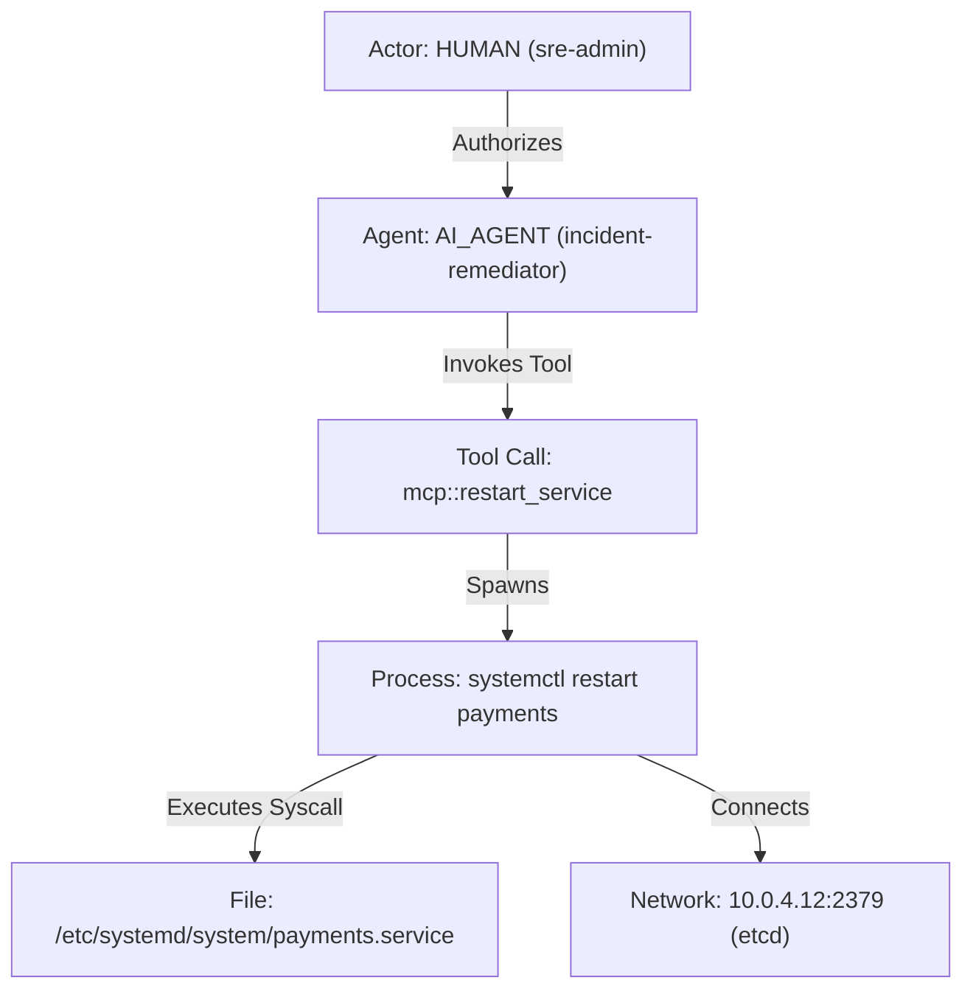

# Sentinel Runtime Engine v1 — Architecture & Product Specification

**Document ID:** `SPEC-SENTINEL-RUNTIME-ENGINE-V1`  
**Status:** `DRAFT — ARCHITECTURE BLUEPRINT & PRODUCT DEFINITION`  
**Date:** 2026-11-04  
**Target Platform:** Linux Workloads, Cloud Infrastructure, Hybrid Human & AI Agent Environments  
**Telemetry Baseline:** Cilium Tetragon v1.8.0, OpenTelemetry Application / GenAI SemConv  
**Commercial Backing:** Sentinel Cloud Ecosystem (API Key / SaaS Integration)  

---

## 1. Executive Product Vision & Strategic Positioning

### 1.1 The Core Problem in Modern Environments
Modern cloud infrastructure is no longer operated solely by human engineers running static bash scripts or fixed CI/CD pipelines. Today, infrastructure execution is **hybrid**:
1. **Human Operators:** Developers and SREs using SSH, sudo, bastion hosts, and administrative CLIs.
2. **Automated Services:** Background cron jobs, deployment microservices, and Kubernetes controllers.
3. **Autonomous AI Coding & Operations Agents:** LLM-based autonomous agents executing tools, dispatching sub-processes, querying internal APIs via Model Context Protocol (MCP), editing configuration files, and triggering cloud deploys.

When an unexpected file modification, exfiltration attempt, or anomalous process occurs, existing security tools produce disconnected observations:
- **Kernel eBPF Sensors (Tetragon/Falco):** Detect `pid 4812 executed curl -X POST https://api.internal/data`, but have **zero visibility** into whether that process was spawned by an authenticated developer, an unattended background daemon, or an autonomous AI agent acting on behalf of a user.
- **Agent Governance Toolkits (Microsoft AGT, LangSmith, Tracing):** Record that `Agent-02 invoked tool exec_shell`, but have **zero visibility** into what syscalls the kernel actually executed, whether child processes were spawned, or if the process escaped its designated working directory.
- **Traditional SIEM / EDR (Sysdig, Datadog, Wazuh):** Collect high-volume logs and apply heuristic pattern matching, but do not provide verifiable cryptographic chains linking human delegation $\to$ agent intention $\to$ kernel telemetry $\to$ tamper-evident proof.

### 1.2 What Sentinel Runtime Is
> **Sentinel Runtime is a local-first observability, security attribution, and verifiable execution audit engine for hybrid environments where humans, automated services, and AI agents interact on Linux infrastructure.**

Sentinel Runtime answers five non-negotiable questions for every security-relevant action:
1. **Actor Attribution:** Who initiated this action? (`HUMAN`, `AI_AGENT`, `SERVICE`, `WORKLOAD`, or `UNKNOWN`).
2. **Authority & Delegation Chain:** Under whose authority was the action taken, through what delegation path, and via which tool/workflow?
3. **Physical Execution:** What processes, kernel syscalls, network connections, and file modifications actually occurred on the host?
4. **Verifiable Provenance:** What exact telemetry was received from the sensor, what was interpreted, and what gaps or uncertainties exist?
5. **Non-Repudiation:** Can an external auditor or incident responder independently verify the evidence chain without trusting the monitored host?

### 1.3 What Sentinel Runtime Is NOT
- **It is NOT a bespoke eBPF kernel sensor:** Sentinel does not rewrite Tetragon. It builds on Tetragon's battle-tested eBPF engine.
- **It is NOT an in-memory alert firehose:** Sentinel focuses on deterministic causal chains, explicit data provenance, and immutable evidence, rather than generating noisy heuristic alerts.
- **It is NOT a closed cloud dependency:** The local engine is 100% autonomous, runs air-gapped/offline, and requires no external network connection to observe, correlate, and persist evidence.

---

## 2. The 7 Core Subsystems of the Local Engine

```
                                  SOURCES
  ┌───────────────────────────────────────────────────────────────────────┐
  │  Tetragon (eBPF)  │  OpenTelemetry  │  Falco / Audit  │  AI Agent SDK │
  └───────────────────┴─────────────────┴─────────────────┴───────────────┘
                                     │
                                     ▼
  ┌───────────────────────────────────────────────────────────────────────┐
  │ 01. Source Integration Layer (Ingress Gateways & Proxies)             │
  └───────────────────────────────────────────────────────────────────────┘
                                     │ (Raw Wire Bytes + Ingress Sequence)
                                     ▼
  ┌───────────────────────────────────────────────────────────────────────┐
  │ 02. Evidence Acquisition & Provenance Engine                          │
  │     - Raw Hash Computation (SHA-256)                                  │
  │     - Loss Domain Separation (Observer, Ringbuf, Throttle, Gap)       │
  │     - Event Contract v2 Materialization                               │
  └───────────────────────────────────────────────────────────────────────┘
                                     │
                  ┌──────────────────┴──────────────────┐
                  ▼                                     ▼
  ┌───────────────────────────────┐   ┌───────────────────────────────────┐
  │ 03. Hybrid Identity Engine    │   │ 04. Correlation & Activity Graph  │
  │     - Human (OIDC/SSH/sudo)   │   │     - Causal DAG Construction     │
  │     - AI Agent (MCP/Session)  │──▶│     - Time-window Expiry          │
  │     - Workload (cgroup/k8s)   │   │     - Process Hierarchy Anchor    │
  │     - Strict "UNKNOWN" Rule   │   │     - Duplicate Suppression       │
  └───────────────────────────────┘   └───────────────────────────────────┘
                  │                                     │
                  └──────────────────┬──────────────────┘
                                     ▼
  ┌───────────────────────────────────────────────────────────────────────┐
  │ 05. Deterministic Detection & Policy Engine                           │
  │     - Allowlist Validation (Binaries, Digests, CIDRs)                 │
  │     - Delegation Boundary Checks (Human-in-the-loop triggers)         │
  │     - Zero-Hallucination Explainability                               │
  └───────────────────────────────────────────────────────────────────────┘
                                     │
                                     ▼
  ┌───────────────────────────────────────────────────────────────────────┐
  │ 06. Evidence, Durability & Ledger Engine                              │
  │     - Append-Only Disk Journal (Spool)                                │
  │     - Local SQLite Hash Chain (SHA-256 links)                         │
  │     - Offline Verification CLI                                        │
  │     - WORM / S3 Object Lock Export Format                             │
  └───────────────────────────────────────────────────────────────────────┘
                                     │
                                     ▼
  ┌───────────────────────────────────────────────────────────────────────┐
  │ 07. Local Runtime Interface & Operation                               │
  │     - CLI (`status`, `audit-log`, `verify-ledger`, `export-dossier`)   │
  │     - Filtered Local Unix Socket RPC                                  │
  │     - Prometheus Scrape Endpoint                                      │
  └───────────────────────────────────────────────────────────────────────┘
```

---

### Subsystem 01: Source Integration Layer
**Purpose:** Safely ingest heterogeneous runtime signals while isolating the host and runtime from sensor vulnerabilities.

- **Tetragon gRPC & JSONL Collector:**
  - Pins to Tetragon `v1.8.0`.
  - Connects downstream to a read-only gRPC proxy (`src/collectors/tetragon-readonly-proxy.js`) exposing only `GetVersion` and `GetEvents`.
  - Preserves exact upstream protobuf wire bytes, including unknown fields, without deserialization loss.
- **OpenTelemetry & AI Agent Receiver (MCP Bridge):**
  - Accepts OpenTelemetry spans adhering to GenAI Semantic Conventions (`gen_ai.system`, `gen_ai.agent.id`, `gen_ai.tool.name`).
  - Receives MCP (Model Context Protocol) tool execution receipts containing correlation tokens (`trace_id`, `execution_id`, `caller_identity`).
- **Auditd / Linux System Hooks:**
  - Ingests user login records (`pam`, `utmp`, `sshd`) to map interactive sessions to physical TTYs and process subtrees.

---

### Subsystem 02: Evidence Acquisition & Provenance Engine
**Purpose:** Establish immutable data provenance before any analytical parsing or behavioral transformation occurs.

- **Cryptographic Event Key Invariants:**
  - Employs 8-byte big-endian unsigned length-prefixed domain separation (`src/contracts/event-keys.js`).
  - **Profile A (`RAW_PROVIDER_EVENT`):** For native sensor events with complete process context (`host_id`, `boot_id`, `exec_id`, `event_type`, `source_timestamp`, `raw_payload_sha256`).
  - **Profile B (`DERIVED_CORRELATED_EVENT`):** For joined multi-event occurrences; keyed on constituent event keys, rule ID, and version.
  - **Profile C (`SYNTHETIC_OBSERVABILITY_EVENT`):** For locally generated health, metrics, and gap notifications; keyed on producer identity, epoch, sequence, and event type.
  - **Profile D (`RAW_PARTIAL_PROCESS_EVENT` — Provisional):** For provider events omitting `exec_id`; anchored on `(host_id, boot_id, pid, process_start_time, event_type, source_timestamp, raw_payload_sha256)`.
- **Explicit Loss Accounting:**
  - Strictly separates loss domains: `kernel_ring_buffer`, `sensor_queue`, `sensor_throttle` (rate limits), and `transport_gap`.
  - Rejects synthetic or aggregated loss estimates; if a sensor disconnects, gap duration is recorded, and event count is marked `null` with status `UNKNOWN`.

---

### Subsystem 03: Hybrid Identity & Attribution Engine
**Purpose:** Unify human, automated, and AI agent identities into a cohesive, auditable hierarchy without fabricating links.

- **Actor Types:**
  - `HUMAN`: An authenticated individual (e.g., `user:alice@company.com`, SSH key `SHA256:...`).
  - `AI_AGENT`: An autonomous or assistive AI instance (e.g., `agent:code-refactor-v2`, provider `deepseek-r1`, runner ID `run-9912`).
  - `SERVICE`: A non-agent automated workload (e.g., `systemd:prometheus.service`, k8s `serviceaccount:default/fluentd`).
  - `WORKLOAD`: Containerized microservices identified by OCI container ID and cgroup.
  - `UNKNOWN`: Default when telemetry does not deterministically prove identity.
- **Attribution Confidence Levels:**
  - `PROVEN_CRYPTOGRAPHIC`: Backed by signed tokens, mTLS, or kernel credentials (`ruid`, `euid`, namespace, cgroup).
  - `OBSERVED_CORRELATED`: Backed by temporal and contextual telemetry (e.g., MCP tool invocation timestamp matches process fork within $\Delta t \le 50\text{ms}$ in same PID namespace).
  - `UNRESOLVED_UNKNOWN`: When telemetry conflicts (e.g., C4 EUID collision) or context is absent. **Rule:** An unresolved conflict must never silently default to a trusted actor.

---

### Subsystem 04: Causal Correlation & Activity Graph
**Purpose:** Construct a local, directed causal graph connecting high-level intent to low-level system actions.



- **In-Memory Causal Graph:**
  - Keyed by `(host_id, boot_id, exec_id)`.
  - Maintains parent-child lineage, open file descriptors, active sockets, and associated tool calls.
  - Bounded in-memory state with strict LRU time-window eviction to prevent memory exhaustion under high process churn.
- **Deduplication:**
  - Enforces transactional deduplication inside SQLite. The first valid projected event key wins; duplicates are incremented on suppression counters.

---

### Subsystem 05: Deterministic Detection & Policy Engine
**Purpose:** Evaluate runtime behavior against explicit, explainable security policies without heuristic "black-box" hallucination.

- **Workload & Delegation Profiles:**
  - Exact binary path or SHA-256 digest pinning.
  - Strict destination constraints (hostnames, port numbers, IPv4 CIDRs).
  - Sensitive path boundaries (e.g., `/etc/shadow`, AWS/GCP credential directories).
- **Agent Delegation Boundaries:**
  - Defines which tools an AI agent is authorized to invoke and what OS-level binaries those tools are allowed to spawn.
  - Triggers an alert or observation when an agent attempts an action outside its authorized delegation tree (e.g., an agent tasked with code review running `nmap` or modifying `/etc/hosts`).
- **Observe-Only Baseline:**
  - Produces structured security verdicts: `NORMAL`, `SUSPICIOUS`, `POLICY_VIOLATION`, or `UNKNOWN`.
  - Does not attempt inline SIGKILL, container suspension, or network isolation in the engine core.

---

### Subsystem 06: Evidence, Durability & Ledger Engine
**Purpose:** Store all accepted events and verdicts in a tamper-evident, crash-resilient local ledger.

- **Durable Disk Spool (Pre-Ingest Journal):**
  - Append-only write-ahead log for raw protobuf wire bytes before parsing.
  - Ensures that if the collector or engine restarts, uncommitted records are re-delivered without data loss.
- **SQLite Evidence Hash Chain:**
  - Uses `node:sqlite` built-in engine.
  - Every committed record includes: `event_id`, `source_event_key`, `canonical_payload`, `timestamp`, and `prev_hash`.
  - Hash formula: $\text{RecordHash}_n = \text{SHA-256}(\text{RecordHash}_{n-1} \,\|\, \text{CanonicalPayload}_n)$.
- **Tamper Boundaries:**
  - Detects accidental corruption or unauthorized row deletions/insertions.
  - *Acknowledged Limit:* A root user on the host can rewrite SQLite and recompute the chain. True forensic non-repudiation requires external anchoring (Subsystem 07 / Cloud integration).

---

### Subsystem 07: Local Runtime Interface & Operation
**Purpose:** Provide operators with transparent, accessible tools to inspect, verify, and export runtime telemetry.

- **CLI Tooling (`bin/sentinel-runtime.js`):**
  - `status`: Reports engine health, active collector status, loss counters, and version.
  - `validate-v2`: Standalone schema and cryptographic key validator for offline event files.
  - `verify-ledger`: Traverses SQLite hash chain from genesis to head and reports verification status.
  - `export-dossier`: Bundles an incident or time window into a standalone, verifiable evidence dossier (JSONL + cryptographic manifest).
- **Telemetry Endpoints:**
  - Prometheus `/metrics` endpoint exposing ingestion throughput, queue depths, deduplication counts, and loss metrics.
  - Unix socket RPC interface restricted to administrative accounts (`0660` mode).

---

## 3. Build vs. Buy: Architecture & Dependency Matrix

To maximize engineering velocity, minimize maintenance burden, and eliminate bespoke reinventing of wheels, Sentinel Runtime follows a strict **Build vs. Buy / Ecosystem Reuse** discipline:

| Component | Architecture Decision | Reused Technology | Proprietary Sentinel Code | Rationale |
|---|---|---|---|---|
| **Kernel Sensor** | **REUSE** | Cilium Tetragon (v1.8.0) | None (eBPF code is upstream) | eBPF kernel instrumentation requires years of engineering, kernel matrix support, and maintenance. Tetragon is best-in-class. |
| **Telemetry Transport** | **REUSE** | OpenTelemetry Collector / Protobuf | Minimal custom framing | OpenTelemetry is the global standard. Reusing OTel protocols avoids inventing a proprietary transport layer. |
| **Local Storage** | **REUSE** | SQLite (`node:sqlite`) | Hash-chain integrity logic | SQLite is zero-maintenance, crash-resilient, embedded, and ACID-compliant. |
| **Fleet Broker** | **REUSE (Future)** | NATS JetStream | Consumer adapter | For multi-host deployments, NATS JetStream provides persistent, lightweight, high-performance messaging without Kafka overhead. |
| **Metrics & Ops** | **REUSE** | Prometheus & Grafana | Metric registry & exporters | Standard observability stack. Operators already have Prometheus/Grafana deployed. |
| **WORM Storage** | **REUSE** | S3 Object Lock (AWS/MinIO) | Dossier packager & signer | Compliance-grade WORM (Write Once Read Many) storage exists in cloud object stores. No need to build custom immutable storage. |
| **Identity Providers** | **REUSE** | OIDC, SPIFFE/SPIRE, OS PAM | Identity mapper | Enterprise identity belongs in OIDC/Okta/Keycloak. Sentinel maps existing tokens. |
| **Event Contract v2** | **BUILD** | JSON Schema Draft 2020-12 | Contract schemas & validators | Core Sentinel IP: rigorous cryptographic identity, provenance tracking, and explicit loss domains. |
| **Hybrid Identity Engine** | **BUILD** | None (Novel domain) | Attribution & delegation engine | Core Sentinel IP: linking Human $\leftrightarrow$ AI Agent $\leftrightarrow$ Kernel execution. No standard tool does this today. |
| **Activity Graph** | **BUILD** | None (Custom DAG) | Causal graph & time-window LRU | Core Sentinel IP: deterministic process-tree correlation across hybrid boundaries. |
| **Evidence Dossier** | **BUILD** | Standard SHA-256 / Ed25519 | Manifest generator & verifier | Core Sentinel IP: self-contained, offline-verifiable forensic evidence bundles. |

---

## 4. Integration with Sentinel Cloud (The SaaS & Commercial Layer)

### 4.1 Strict Architectural Boundary: The "Air-Gap Guarantee"
> **Sentinel Runtime Agent must be 100% functional, self-contained, and useful without Sentinel Cloud.**

If an enterprise installs Sentinel Runtime on an isolated network with zero Internet connectivity:
- The local engine ingests Tetragon events.
- The hybrid identity engine maps local sessions and agents.
- The evidence ledger writes to local SQLite with SHA-256 chaining.
- The CLI verifies ledger integrity and exports dossiers.
- Zero telemetry is dropped due to lack of cloud connectivity.

### 4.2 Where Sentinel Cloud Adds Value (The Paid Enterprise Layer)
Sentinel Cloud is not a gatekeeper for basic functionality. It is the **fleet management, multi-host correlation, and enterprise governance platform** that operators willingly pay for:

```
  ┌────────────────────────────────────────────────────────────────────────┐
  │                           SENTINEL CLOUD (SaaS)                        │
  │                                                                        │
  │  ┌────────────────────────┐  ┌───────────────────────────────────────┐ │
  │  │ Fleet Control Plane    │  │ Central Activity Graph                │ │
  │  │ - Host Enrollment      │  │ - Multi-host blast radius analysis    │ │
  │  │ - Health & Heartbeats  │  │ - Cross-node agent tracking           │ │
  │  └────────────────────────┘  └───────────────────────────────────────┘ │
  │  ┌────────────────────────┐  ┌───────────────────────────────────────┐ │
  │  │ Remote Policy Signing  │  │ External WORM Evidence Custody        │ │
  │  │ - Signed policy bundles│  │ - Remote Ed25519 root anchoring       │ │
  │  │ - Key custody & KMS    │  │ - S3 Object Lock compliance storage   │ │
  │  └────────────────────────┘  └───────────────────────────────────────┘ │
  │  ┌────────────────────────┐  ┌───────────────────────────────────────┐ │
  │  │ AI Governance Console  │  │ Enterprise Operations                 │ │
  │  │ - Agent tool audit logs│  │ - RBAC, SSO, Audit trails             │ │
  │  │ - Human-in-loop alerts │  │ - Multi-tenant organization billing   │ │
  │  └────────────────────────┘  └───────────────────────────────────────┘ │
  └────────────────────────────────────────────────────────────────────────┘
                                     ▲
                                     │ (Outbound HTTPS / mTLS, Authenticated)
                ┌────────────────────┴────────────────────┐
                │                                         │
  ┌───────────────────────────┐             ┌───────────────────────────┐
  │ Host 01: Sentinel Runtime │             │ Host N: Sentinel Runtime │
  │ (Tetragon + Local Engine) │             │ (Tetragon + Local Engine) │
  └───────────────────────────┘             └───────────────────────────┘
```

### 4.3 Synergy with Existing Sentinel Cloud Infrastructure
Sentinel Cloud already possesses:
- **Supabase Backend on Railway:** Authenticated user profiles, scan jobs, team/organization schemas, and role-based access.
- **Local API Tokens:** Machine-to-machine authentication tokens (`sentinel_api_token`).
- **Security Intelligence Platform:** Static code analysis, PR auditing, and supply chain threat intelligence.

**The Natural Upsell:**
A customer using Sentinel for code and PR auditing in GitHub/GitLab can deploy Sentinel Runtime on their production hosts and AI agent runner environments. A single unified dashboard displays:
- Code commits $\to$ PR security review $\to$ Production deployment $\to$ Runtime kernel execution by AI agents and developers.

---

## 5. Commercial Model & Licensing Strategy

### 5.1 Open-Core Model Recommendation

```
┌──────────────────────────────────────────────────────────────────────────┐
│ SENTINEL COMMUNITY (Open Source — Recommended: Apache-2.0)               │
│ - Local Runtime Engine & CLI                                             │
│ - Tetragon v1.8.0 integration & Read-only proxy                          │
│ - Event Contract v1 & v2 validation                                      │
│ - Local SQLite evidence ledger & hash chain                              │
│ - Local AI Agent / MCP correlation                                       │
│ - 100% Free, self-hosted, unconstrained local use                        │
└──────────────────────────────────────────────────────────────────────────┘
                                     │
                                     ▼
┌──────────────────────────────────────────────────────────────────────────┐
│ SENTINEL ENTERPRISE (Commercial License & Annual Cloud Subscription)     │
│ - Centralized Fleet Management & Agent Enrollment                        │
│ - Central Multi-Host Activity Graph (cross-node attack tracing)          │
│ - External WORM Evidence Anchoring (S3 Object Lock + KMS signing)        │
│ - Enterprise AI Agent Governance Dashboard (tool authorization policies) │
│ - Enterprise RBAC, SAML/OIDC SSO, and Compliance Audit Packs             │
│ - SLA, Dedicated Support, and Distribution-Certified Packages            │
└──────────────────────────────────────────────────────────────────────────┘
```

### 5.2 Transitioning from BUSL-1.1
- **Current State:** The repository is currently marked `BUSL-1.1` in `package.json`. While public on GitHub, BUSL-1.1 is "source-available," not OSI-approved open source.
- **Adoption Risk:** Enterprise security teams and developers are often hesitant to adopt agentic runtime security software governed by restrictive licenses.
- **Recommended Action:**
  1. Maintain `BUSL-1.1` during Phase 001 development while the architecture solidifies.
  2. Once the Local Engine v1 specification passes technical review, transition the **local engine core** to **`Apache-2.0`** to foster community adoption, vendor trust, and academic/security community auditing.
  3. Retain commercial licensing for the **Sentinel Cloud Control Plane**, fleet orchestrator, and advanced enterprise connectors.

---

## 6. Competitor Capability & Differentiator Matrix

| Feature / Domain | Cilium Tetragon | Falco | Sysdig Secure | Datadog CWP | **Sentinel Runtime + Cloud** |
|---|---|---|---|---|---|
| **Kernel Sensor** | Native eBPF | eBPF / Kernel Module | eBPF / Agent | Agent + eBPF | **Reuses Tetragon eBPF** (no reinvented wheel) |
| **AI Agent / MCP Attribution** | ❌ None | ❌ None | ❌ None | ❌ None | ✅ **Native** (Human $\leftrightarrow$ AI Agent $\leftrightarrow$ Tool Call $\leftrightarrow$ Syscall) |
| **Deterministic Causal DAG** | Partial (Process Tree) | ❌ None (rules are stateless across sources) | Proprietary Backend | Proprietary Backend | ✅ **Native local Activity Graph** (open contract) |
| **Original Wire Byte Retention** | ❌ Deserializes | ❌ Drops raw frames | ❌ Cloud-ingested | ❌ Cloud-ingested | ✅ **Preserves exact protobuf bytes & unknown fields** |
| **Cryptographic Event Identity** | ❌ Internal counters | ❌ Rule IDs | ❌ UUIDv4 | ❌ Log IDs | ✅ **Domain-separated, length-prefixed SHA-256 keys** |
| **Loss & Gap Honesty** | Metrics available | Drops reported | Backend estimates | Backend estimates | ✅ **Explicit loss domains; disconnect = UNKNOWN** |
| **Tamper-Evident Local Ledger** | ❌ None (ephemeral stream) | ❌ None (log output) | ❌ None (stream to SaaS) | ❌ None (stream to SaaS) | ✅ **Local SQLite SHA-256 chain + offline CLI verifier** |
| **Air-Gap / Offline Autonomy** | ✅ Yes (raw daemon) | ✅ Yes (daemon) | ❌ SaaS-dependent | ❌ SaaS-dependent | ✅ **100% autonomous local engine; Cloud is optional** |
| **Commercial Model** | Open Source (Cilium) | Open Source (CNCF) | Expensive Enterprise SaaS | Expensive Enterprise SaaS | **Open-Core Engine + Affordable SaaS / Annual Bundle** |

---

## 7. Criteria for "Engine Complete" (Stop Conditions for Local MVP)

To prevent scope creep and endless feature expansion, the **Sentinel Runtime Local Engine v1** is declared **COMPLETE** and ready for commercial pilot when, and only when, the following 6 gates are closed:

### Gate 1: Event Contract v2 Frozen (`SCHEMA-V2-FROZEN`)
- [ ] Schema v2 candidate approved by independent cryptographic review.
- [ ] All 14 documented event families compile cleanly under JSON Schema Draft 2020-12.
- [ ] SHA-256 anchor permanently frozen and committed to repo.
- [ ] Normalizer v2 unit tests pass 100%.

### Gate 2: Live Sensor Telemetry Gate (`LIVE-SENSOR-V1`)
- [ ] Validated against a live, running Tetragon v1.8.0 daemon on Linux.
- [ ] Exact TracingPolicy CRDs defined and tested for the 6 core MVP hooks (`do_sys_openat2`, `vfs_read`, `tcp_v4_connect`, `tcp_v6_connect`, `tcp_sendmsg`, `cap_capable`).
- [ ] Pinned Prometheus loss counters (`ringbuf_lost`, `sensor_throttle`) verified with real counter-delta and reset tests.

### Gate 3: Restart Durability & Gap Policy Gate (`DURABILITY-V1`)
- [ ] Append-only disk spool (pre-ingest journal) implemented in the gateway.
- [ ] Kill collector while proxy runs: verify spool accumulates and collector drains on restart without event loss.
- [ ] Kill proxy after sync: verify recovery without partial-frame corruption.
- [ ] Disconnect Tetragon: verify `EVENT_LOSS` is recorded with `status: UNKNOWN` and `count: null` (no fabricated counts).

### Gate 4: Hybrid Attribution & MCP Correlation Gate (`HYBRID-ATTRIBUTION-V1`)
- [ ] Standard OpenTelemetry / MCP receiver accepts tool execution context (`agent_id`, `caller_id`, `tool_name`, `trace_id`).
- [ ] Deterministic matcher binds tool call to Tetragon process execution within bounded time window.
- [ ] If correlation cannot be proven, attribution is explicitly marked `UNKNOWN`.

### Gate 5: Standalone Evidence Dossier & Offline Verifier (`EVIDENCE-V1`)
- [ ] CLI command `sentinel-runtime export-dossier` packages an incident time window into a standalone archive.
- [ ] CLI command `sentinel-runtime verify-ledger` validates the hash chain offline without network access.
- [ ] Tampering test: manual modification of an SQLite row is immediately detected and flagged.

### Gate 6: Native Linux Package & Systemd Gate (`DEPLOYMENT-V1`)
- [ ] Verified native package installation on Ubuntu 22.04 LTS and Ubuntu 24.04 LTS.
- [ ] Systemd service separation (`sentinel-runtime-proxy` vs `sentinel-runtime`) verified with least-privilege socket permissions (`0660`).
- [ ] Full automated test suite passes 100% on native Linux (0 skips, 0 failures).

---

## 8. Prioritized Roadmap

```
PHASE 001C (DONE)       ──▶ Event Contract v2 Candidate Published & Verified on CI (226/226 Linux Pass)
                                │
PHASE 001D (NEXT)       ──▶ Live Sensor Telemetry Validation (Tetragon v1.8.0 Real Hooks & Metrics)
                                │
PHASE 001E              ──▶ Stream Durability & Disk Spool Journal (Crash Recovery & Gap Policy)
                                │
PHASE 002               ──▶ Hybrid Identity Engine & MCP Tool Correlation (Human + AI Agent Attribution)
                                │
PHASE 003               ──▶ Evidence Dossier Export & S3 Object Lock / WORM External Anchoring
                                │
PHASE 004               ──▶ Packaging & Distribution Pilot (Ubuntu 22.04/24.04 Single-Host Pilot)
                                │
PHASE 005               ──▶ Sentinel Cloud Fleet Integration (Enterprise Commercial SaaS Upsell)
```

**Immediate Instruction for Engineering Agents (Gemini, Codex, Subagents):**
Do NOT begin Phase 001D implementation without an authorized TracingPolicy test plan. Do NOT implement bespoke messaging brokers, distributed consensus, or UI dashboards. Adhere strictly to the 7 subsystems and build-vs-buy decisions established in this document.
