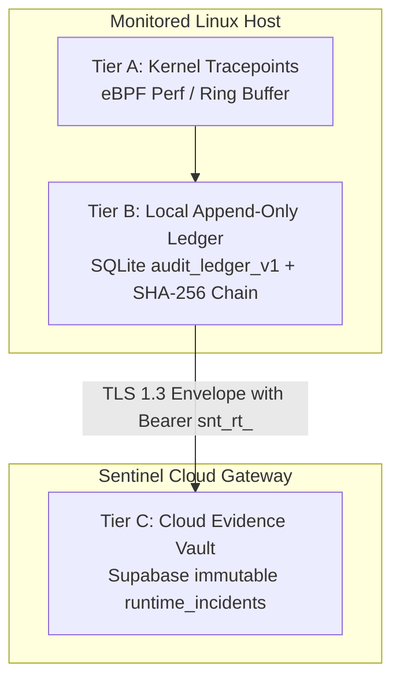

# Sentinel Digital Evidence Handling Standard (V1)
**Document ID:** STD-EVD-27037-V1  
**Status:** APPROVED / NORMATIVE  
**Scope:** Custody, Hashing, Cryptographic Verification, and Ingestion Pipeline  
**Applicability:** Sentinel Runtime Daemon, Sentinel Cloud Ingestion Gateway, Security Engineers  

---

## 1. Purpose & Normative Scope

This standard governs the identification, collection, acquisition, preservation, and chain of custody for digital evidence generated by Sentinel Runtime sensors.

It complies with:
- **ISO/IEC 27037:2012** (*Guidelines for identification, collection, acquisition and preservation of digital evidence*)
- **ISO/IEC 27041:2015** (*Guidance on assuring suitability and adequacy of incident investigative method*)
- **RFC 3161** (*Internet X.509 Public Key Infrastructure Time-Stamp Protocol*)
- **FIPS PUB 180-4** (*Secure Hash Standard - SHA-256*)

---

## 2. Evidence Architecture & Custody Tiers

Evidence acquired across the Sentinel mesh is categorized into three distinct evidentiary tiers:



### 2.1 Tier A: Kernel Tracepoints (Volatile Memory)
- **Source:** Tetragon / eBPF kernel probes attached to `sys_enter_execve`, `sys_enter_connect`, `sys_enter_openat`.
- **Integrity:** Non-swappable kernel ring buffer memory with drop detection counters (`loss_events_count`).
- **Retention:** Ephemeral buffer window (typically $\le 500$ ms before state transition).

### 2.2 Tier B: Local SQLite Append-Only Ledger
- **Source:** Local agent daemon persistence layer (`audit_ledger_v1`).
- **Integrity Mechanism:** Cryptographic SHA-256 hash chaining:
  $$H_i = \text{SHA-256}(H_{i-1} \parallel \text{Timestamp} \parallel \text{EventPayload})$$
- **Verification:** Any tampering with historical rows invalidates the forward hash chain.

### 2.3 Tier C: Cloud Evidence Vault
- **Source:** Ingested envelopes received over TLS 1.3 with API Key authentication (`snt_rt_...`).
- **Payload Verification:** The Cloud Ingestion worker computes an independent SHA-256 digest over the sanitized payload envelope and stores it in `evidence_record_hash`.

---

## 3. Cryptographic Anchoring & Epistemic Distinctions

### 3.1 Local SHA-256 Digest vs External RFC 3161 TSA
A fundamental compliance principle of Sentinel is strict transparency regarding cryptographic time anchoring:

1. **Local SHA-256 Digest (Guaranteed):**
   - Computed immediately by the agent upon incident detection.
   - Pinned into the envelope before network dispatch.
   - Proves that the evidence structure has not been modified post-detection.
2. **RFC 3161 External Time-Stamp Authority (Optional Add-On):**
   - In standard deployments, timestamps reflect local NTP-synchronized host time.
   - Unless an external TSA server (e.g. DigiCert, FreeTSA) is explicitly configured and a `.tsr` token is returned, Sentinel Case Files **MUST NOT** claim RFC 3161 compliance.
   - The UI and reports must explicitly state: `LOCAL CLOCK (External TSA Not Anchored)`.

---

## 4. Chain of Custody Hand-off Record

When forensic evidence is exported from Sentinel Cloud for external audit or legal proceedings, it must be accompanied by the standard JSON-LD Custody Receipt:

```json
{
  "@context": "https://sentinel.dev/schemas/v1/chain-of-custody.jsonld",
  "evidenceId": "evd_04ffeae2-50f8-43a8-97a2-06f88659a5c4",
  "clientIncidentId": "inc_scenario_4_ssh_key_theft_1794129606672",
  "acquisitionTimestamp": "2026-11-08T03:55:12.672Z",
  "originatingHost": {
    "hostId": "host_staging_pruebas_01",
    "deviceName": "pruebas",
    "kernelVersion": "Linux 6.6.36-wsl2",
    "sensor": "Tetragon eBPF v1.8.0"
  },
  "cryptographicIntegrity": {
    "algorithm": "SHA-256",
    "hash": "e3b0c44298fc1c149afbf4c8996fb92427ae41e4649b934ca495991b7852b855",
    "timeAuthority": "HOST_NTP_LOCAL",
    "rfc3161Anchored": false
  },
  "ingestionGateway": {
    "endpoint": "https://sentinel-psi-nine.vercel.app/api/runtime/telemetry",
    "transport": "TLS_1_3_AES_256_GCM_SHA384"
  }
}
```

---

## 5. Evidence Retention & Disposal Policy
- **Enterprise Plan Standard Retention:** 365 calendar days from ingestion.
- **Data Sanitization:** Process arguments and environment variables are hashed or scrubbed client-side prior to transmission to comply with GDPR, HIPAA, and ISO 27701 privacy requirements.
