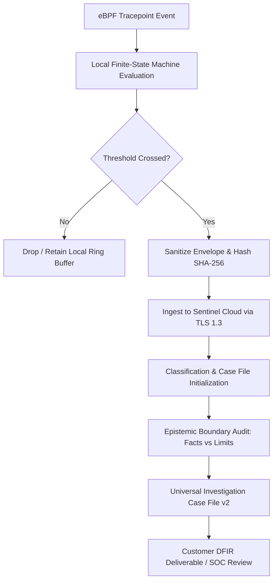

# Sentinel Incident Investigation Standard (V1)
**Document ID:** STD-SEC-27035-V1  
**Status:** APPROVED / NORMATIVE  
**Scope:** Sentinel Runtime & Sentinel Cloud Evolving DFIR Ecosystem  
**Applicability:** SOC Operators, DFIR Analysts, Automated Decision Engines, AI Code Assistants  

---

## 1. Purpose & Normative Scope

This standard establishes the mandatory operational methodology and epistemic boundaries for investigating, analyzing, and reporting runtime security incidents detected by Sentinel Runtime agents and ingested into Sentinel Cloud.

It formally aligns Sentinel's investigation procedures with:
- **ISO/IEC 27035-1:2023 & 27035-2:2023** (*Information security incident management — Principles and guidelines*)
- **ISO/IEC 27042:2015** (*Guidelines for the analysis and interpretation of digital evidence*)
- **NIST SP 800-61 Rev. 3** (*Incident Response Recommendations and Considerations for Cybersecurity Risk Management*)
- **RFC 5737** (*IPv4 Address Blocks Reserved for Documentation*)

---

## 2. Core Epistemic Principles

### 2.1 The Principle of Factual Claim Boundary
An incident report or automated case file generated by Sentinel **MUST NEVER** assert an inferential conclusion as an observed fact. Every assertion must strictly reflect the direct observation capability of the sensor.

- **Observed:** A syscall tracepoint was triggered by a specific process (`sys_enter_read`, `sys_enter_connect`).
- **Inferred:** The process attempted exfiltration or established an interactive C2 tunnel.
- **Rule:** If the sensor observed only `connect()`, the report must state `OUTBOUND_CONNECT_ATTEMPT`. It must **NOT** claim data was exfiltrated without direct payload correlation.

### 2.2 The Principle of Documentation & Lab Subnet Transparency
Any destination IP address falling within RFC 5737 reserved documentation ranges:
- `192.0.2.0/24` (TEST-NET-1)
- `198.51.100.0/24` (TEST-NET-2)
- `203.0.113.0/24` (TEST-NET-3)
- `127.0.0.0/8` (Loopback)

**MUST BE EXPLICITLY LABELED** as a synthetic benchmark or documentation range. Reports and consoles **MUST NEVER** designate RFC 5737 endpoints as real-world adversarial C2 servers.

---

## 3. Observation Scale (Epistemic Maturity Model)

To prevent over-claiming and misattribution in customer-facing deliverables, all findings must classify events along the formal 5-step Epistemic Maturity Scale:

| Level | State Identifier | Evidentiary Basis | Sensor Capability |
| :--- | :--- | :--- | :--- |
| **L1** | `PROCESS_SPAWN_OBSERVED` | eBPF `sched_process_exec` | Kernel tracepoint verified |
| **L2** | `FILE_ACCESS_OBSERVED` | eBPF `sys_enter_read` / `sys_enter_openat` | File descriptor & path verified |
| **L3** | `OUTBOUND_CONNECT_ATTEMPT` | eBPF `sys_enter_connect` | Destination IP and Port verified |
| **L4** | `TRANSPORT_CONNECTED` | eBPF `sys_exit_connect` (ret == 0) | Socket handshake completed |
| **L5** | `DATA_EXFILTRATION_CONFIRMED` | eBPF socket buffer inspect / egress delta correlation | Source bytes matched to socket payload |

If Level 5 has not been captured, the investigation classification **MUST REMAIN** `POTENTIAL_CREDENTIAL_EXPOSURE` or `OUTBOUND_NETWORK_ANOMALY`. It must never be closed as confirmed theft.

---

## 4. Identity & Attribution Tuple

In modern Linux containerized environments, Linux Process Identifiers (PIDs) are subject to rapid recycling and namespace isolation. A standalone PID (`pid:13400`) does **NOT** constitute a strong forensic identity.

Per ISO/IEC 27042 Section 8.3, forensic identity attribution requires the **Strong Process Tuple**:

$$\text{StrongIdentity} = \langle \text{HostID}, \text{BootID}, \text{ExecID}, \text{PID}, \text{StartTimeNs}, \text{CGroupPath}, \text{BinaryHash} \rangle$$

Where:
- `HostID`: Immutable hardware UUID or cloud instance ID pinned at enrollment.
- `BootID`: Linux kernel `/proc/sys/kernel/random/boot_id` preventing reboot PID collision.
- `ExecID`: Monotonically increasing kernel exec counter or Tetragon execution ID.
- `BinaryHash`: SHA-256 digest of `/proc/$PID/exe`.

---

## 5. Investigation Workflow & Case File Taxonomy

### 5.1 Case Classification Taxonomy
1. `POTENTIAL_INTERACTIVE_REVERSE_SHELL`: Outbound connect observed followed by interpreter spawn.
2. `POTENTIAL_CREDENTIAL_EXPOSURE`: Private key or secret file read followed by network connect attempt.
3. `POTENTIAL_ENVIRONMENT_VARIABLE_EXPOSURE`: Sensitive configuration file read (`.env`) with network egress.
4. `PRIVILEGE_PROBE_ANOMALY`: `CAP_SETUID` or privileged capability enumeration prior to process execution.

---

## 6. Audit & Review Frequency
This standard is subject to bi-annual review by the Security Architecture Review Board (SARB) and mandatory post-incident audit whenever a false positive rate exceeds 0.05% in production fleets.
